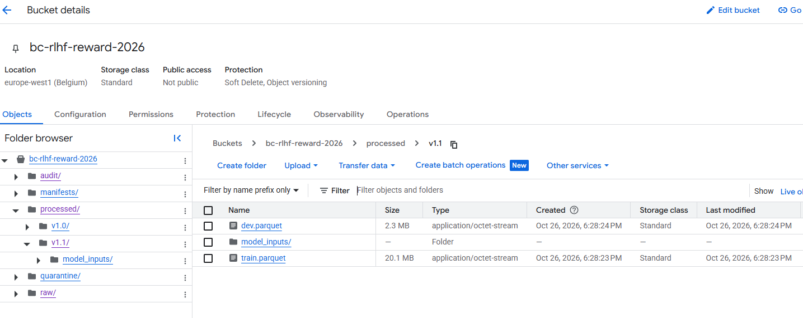
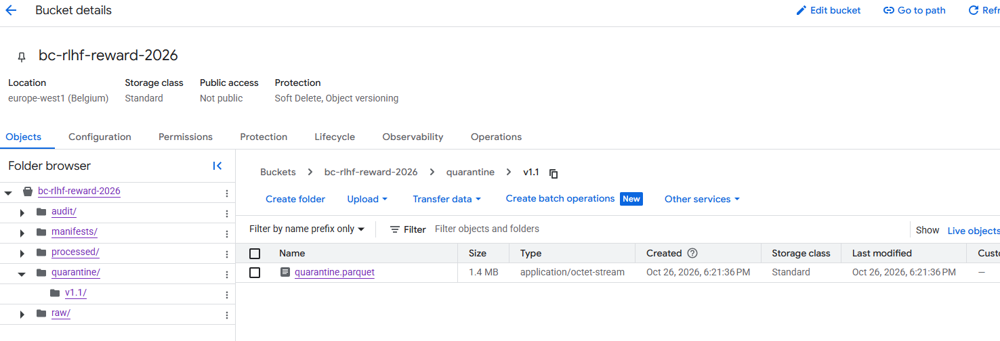
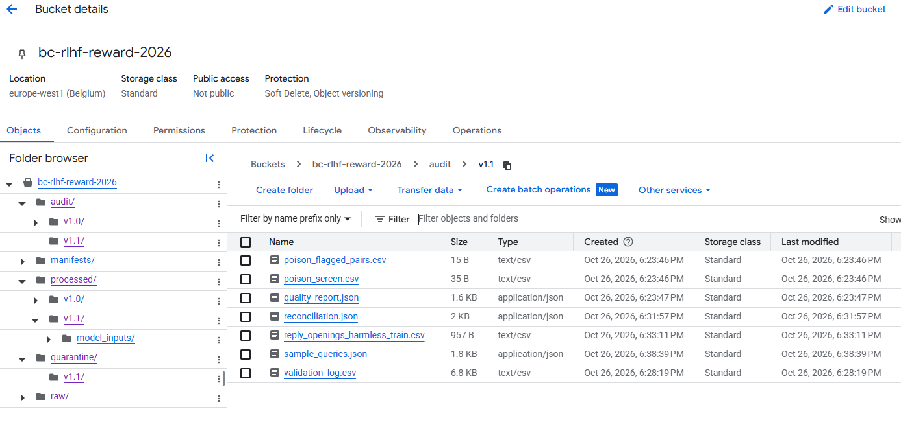
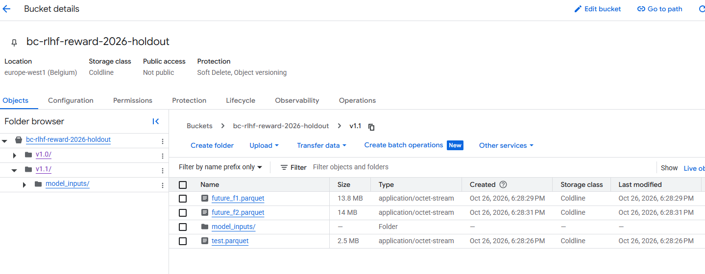

# 👍👎 Response Preference Prediction (RLHF Reward Modeling) — Milestone 2

This is Milestone 2 of my Data Handling and Infrastructure for AI project. It picks up where Milestone 1 left off, in bounchun/rlhf-reward-model-pipeline-m1 (release data-v1.0), and the full commit history came across with it, so you can trace how the project got from M1 to M2. Anything from Milestone 1 that stayed the same is covered in [Builds on Milestone 1](#-builds-on-milestone-1).

| | |
|---|---|
| **Task** | Given a conversation and two replies, predict which one a crowdworker preferred (reward modelling for RLHF) |
| **Data** | [`Anthropic/hh-rlhf`](https://huggingface.co/datasets/Anthropic/hh-rlhf), MIT licence, pinned to commit `09be8c5bbc57cb3887f3a9732ad6aa7ec602a1fa` |
| **Dataset version** | v1.1 (M1 was v1.0). The raw data and split haven’t changed. M2 adds new validation checks, moves failed rows into quarantine instead of dropping them, masks personal data, and produces inputs the model can use directly |

## 🧭 Milestone 2 at a glance (dataset version v1.1)

| Milestone 2 requirement | Where it is |
|---|---|
| EDA that drives decisions | `src/eda.py` (`make eda`) → 9 figures, `docs/eda/eda_summary.json` and `docs/eda/findings.csv` (finding → decision → limitation). Summary in [M2.2](#m22-what-the-eda-found-and-what-it-changed) |
| Pipeline: acquire → validate → store → transform | Steps 1–11, run with (`make all`). The full pipeline is laid out in [M2.1](#m21-pipeline-architecture) |
| Validation that fails loudly | `src/contract.py` holds two data contracts. The raw contract runs in step 3: any row that fails is moved to a quarantine file, along with the reason, the source file and the line number. The processed contract runs in step 9 and checks  17 rules, logging the results to `audit/v1.1/validation_log.csv`. If a HARD rule fails, the pipeline stops before anything gets uploaded. |
| Cleaning and transformation | In step 3 the text gets normalised, PII is masked, and anything broken is quarantined (there are 7 reasons a row can end up there). Step 5 does the A/B swap and builds the features. Step 7 adds an outlier flag, using thresholds fitted on the training set only. Step 11 gets everything ready for the model: contexts are cut from the left, and the log-length features are scaled with the training mean and standard deviation.|
| Second method / reconciliation | `src/reconcile.py` (run it with `make reconcile`) recounts everything straight from the raw files using plain Python, independently of the pipeline. Its numbers have to match the pipeline’s on all 7 checks.|
| Reproducibility | The data commit and library versions are pinned, and the splits are hash-based, so rerunning the pipeline gives byte-identical output (there’s a test for this). On every push, GitHub Actions runs the 43 tests and an offline demo (see .github/workflows/ci.yml).|
| Changes since v1.0 | [M2.3](#m23-changes-since-v10-and-why) |

### M2.1 Pipeline architecture

```text
make all  (Colab or locally · runs the steps in order, top to bottom, and each step writes its log to manifests/v1.1.json).
│
├── 1 SOURCE  (manual, once)
│   ├── Anthropic/hh-rlhf          Hugging Face, MIT licence, commit 09be8c5 pinned
│   └── setup_gcs.sh               creates 2 buckets (versioning + lifecycle),
│                                  2 service accounts (pipeline `pipeline-sa` + training `train-sa`) 
│
├── 2 INGEST
│   ├── step1_scrape_raw           8 files over HTTPS ─────────────▶ data/downloads/ + SHA-256
│   └── step2_store_raw            upload, read back, verify ──────▶ main bucket: raw/
│
├── 3 VALIDATE
│   ├── step3_clean                raw data contract, PII masking
│   │                              bad rows (reason, file, line) ──▶ main bucket: quarantine/v1.1/
│   ├── step4_quality_checks       hard checks, poisoning screen ──▶ main bucket: audit/v1.1/
│   └╌╌ beam_validate              optional: same contract on Apache Beam, counts must match
│
├── 4 TRANSFORM
│   ├── step5_features             group_id, A/B swap → label, lengths, refusal flags
│   ├── step6_filter               future reserve, 30k working set
│   ├── step7_split                80/10/10 by hashed group, outlier cut-off fitted on train
│   └── step8_shard                skipped (one file is faster at this size)
│
├── 5 STORE
│   ├── step9_store_processed      17-rule contract; HARD violation ⇒ nothing uploaded
│   │                              train, dev ─────────────────────▶ main bucket: processed/v1.1/
│   │                              test, F1, F2 ───────────────────▶ holdout bucket: v1.1/
│   ├── step10_review_sample       blind 200-pair sheet ───────────▶ stays local
│   └── step11_model_inputs        truncated text, scaled lengths ─▶ model_inputs/ in both buckets
│
└── 6 CHECK
    ├── sample_queries             sanity queries on train/dev ────▶ main bucket: audit/v1.1/
    ├── reconcile                  recount from raw, 7 checks ─────▶ main bucket: audit/v1.1/
    └── eda                        9 figures + findings ───────────▶ GitHub: docs/eda/

gs://bc-rlhf-reward-2026                      (main bucket · Standard · versioning on)
├── raw/                           original files from Hugging Face, write-once
├── quarantine/v1.1/               rejected rows with reason, file and line
├── processed/v1.1/                train.parquet, dev.parquet
│   └── model_inputs/              train, dev, numeric_scaler.json ──▶ read by Milestone 3
├── audit/v1.1/                    validation log, quality report, queries, reconcile
└── manifests/                     v1.1.json ···· copy ····▶ GitHub: manifests/

gs://bc-rlhf-reward-2026-holdout              (Coldline · training account has no access)
└── v1.1/                          test, future_f1, future_f2 (+ model_inputs/), read once

```

**ETL, not ELT.** The transformations (parsing conversations, the A/B swap, hashing groups, masking PII) are Python code, not SQL, and the whole dataset is 79 MB of raw files, so the work runs in one Python process (about 2½ minutes for steps 1–11) and only the cleaned Parquet files are loaded into storage. The raw layer is kept untouched (write-once, versioned bucket), so the main advantage of ELT — fixing a rule and re-running from the raw data — is kept too. Apache Beam / Dataflow (Lecture 6) would add cost and machinery without any benefit at this size; the pipeline still follows the same ideas: a data contract per row, a quarantine with reasons, counters, idempotent reruns and a reconciliation.

### M2.2 What the EDA found, and what it changed

All numbers come from `make eda` on the real data (`docs/eda/eda_summary.json`). Structure and quality checks look at all rows; distributions and relationships use **train only**; baselines are fitted on train and scored on dev; the holdout bucket is never read.

| # | Finding (real data, v1.1) | Decision in the pipeline |
|---|---|---|
| 1 | In the raw files the preferred reply is **always** `chosen`: a model could reach 100% by learning the column | A/B swap by `hash(pair_id)`; label share now 49.8% in train |
| 2 | 1,323 of 169,352 raw pairs break a rule; the rate differs by subset (13.0 per 1,000 in helpful-rejection-sampled vs 4.7 in harmless-base; χ² p = 6e-65, Cramér's V = 0.04), so the problems are not "missing completely at random" | Quarantine with reason and source line instead of a silent drop; `rows_read = kept + quarantined` asserted (fig. 1) |
| 3 | 93% of pairs share their opening prompt with another pair, and 92% of official test pairs have their prompt in the official train split | Confirms the M1 group split; contract rule "no `group_id` in two splits" (fig. 2) |
| 4 | Reply length is right-skewed (skew 2.0, −0.4 after `log1p`); the 1.5×IQR fence would flag 5% of replies | Flag (not delete) above the train 99th percentile (210 words); `log1p` lengths in step 11 (fig. 3) |
| 5 | 9.7% of train contexts are longer than 256 words | Step 11 keeps the newest turns (left truncation) and records `context_truncated` |
| 6 | The preferred reply is longer in 58% of helpful-base pairs but only 42% of harmless-base pairs; pooled (52%) this cancels out (Cramér's V = 0.14) | Length is a shortcut that depends on the subset: M3 reports accuracy per subset and per length-gap slice (fig. 4) |
| 7 | Length alone gets 51.4% on dev pooled, but 58.2% with one length model per subset | These are the baselines the M3 reward model must beat on every subset (fig. 5) |
| 8 | 47% of replies use the typographic apostrophe ’, so the v1.0 refusal regex (straight `'`) flagged only 0.09% of pairs | Refusal phrases rebuilt from the data and made apostrophe-agnostic: 2.2% flagged |
| 9 | When only one reply is a refusal, it is preferred in 75% of harmless-base pairs but 27% of helpful-base pairs | A second subset-dependent shortcut: refusal slice per subset in M3 (fig. 6) |
| 10 | Inputs are correlated: reply A vs B length ρ = 0.50 pooled but only 0.27–0.54 within subsets (the subsets differ in typical length); turns vs context words ρ = 0.82 | Use the log length ratio for linear baselines; the two-reply correlation is partly a subset effect, another reason to evaluate per subset (fig. 7) |
| 11 | Week 4 inference: rows are clustered in prompt groups, so intervals were recomputed with a group bootstrap (resampling prompt groups, not rows). Design effect only 1.07–1.15; helpful-base minus harmless-base length preference = 16.1 points (95% CI 14.3–17.8); the length effect replicates on held-out dev in all 4 subsets; all 4 tests stay significant after Benjamini–Hochberg | M3 reports group-bootstrap intervals; per-subset test accuracy can only be known to ±3–5 points, so smaller per-subset differences will not be claimed (fig. 8) |
| 12 | Week 5 cross-validation: two scikit-learn Pipelines (a ColumnTransformer length × subset model, and a bag-of-words model whose vocabulary is learned inside each fold) give the same accuracy with random-row folds and with `GroupKFold` on prompt groups (gap ≤ 0.2 points), but group folds vary more between folds | GroupKFold for any CV in M3; bag of words (54.8% dev) is the first text baseline. No measurable inflation from random-row folds for these reply-only models (which does not prove leakage is absent); a model that also reads the prompt could still memorise it (fig. 9) |
| 13 | 304 pairs contain an e-mail and 724 a phone-like number | Masked as `[EMAIL]` / `[PHONE]`; step 4 checks that none is left |

### Lecture 6: the six qualities of a trustworthy pipeline

| Quality | How this pipeline has it |
|---|---|
| Repeatable | Pinned data commit and libraries, hash-based splits; a full rerun gives byte-identical Parquet files and EDA figures |
| Idempotent | Every output file is replaced as a whole (like `WRITE_TRUNCATE`), never appended; `raw/` is write-once and refuses different bytes |
| Observable | Counters printed by every step and stored in the manifest; quarantine with reasons; per-file quarantine rate and JSON-field fingerprint (schema drift) with alerts |
| Testable | 43 unit tests on synthetic data with planted defects, run by GitHub Actions on every push |
| Fails loudly | Checksum mismatch, row-accounting gap, HARD contract violation, reconciliation disagreement or (optionally) an alert stops the run |
| Cost-aware | 79 MB batch: one Python process (~2.5 min) instead of Dataflow workers; Colab and CI are free; buckets are a few hundred MB with lifecycle rules |

**Apache Beam (optional, `make beam`).** `src/beam_validate.py` runs step 3's data contract as a Beam pipeline: a file-reading `DoFn`, a `Validate` `DoFn` with a tagged `bad` output, Beam `Metrics` counters and a `CombinePerKey` for duplicates. It then compares every counter with the pandas step 3. On the real data all 10 counts agree (169,352 read, 168,029 kept, 1,323 quarantined, by reason). The comparison earned its place: in the first version, Beam's built-in `.gz` reading returned only 44,044 rows, and the mismatch exposed it at once. Running it on Dataflow is planned, not implemented: the code uses only portable Beam transforms and should run with `--runner DataflowRunner` and `apache-beam[gcp]`, but it has not been tested there, because at this size the workers would cost more to start than the job takes on one machine.

### From lectures to pipeline rules (Weeks 4–6)

| Lecture | Finding or principle | Evidence in the EDA | Pipeline rule | Test that guards it |
|---|---|---|---|---|
| Week 4 | Repeated prompts break row independence | 93% of pairs share a prompt; 92% of official test prompts in official train | Group split; group bootstrap for intervals | `test_no_group_or_pair_overlap_between_any_splits`, contract rule "no group_id in two splits" |
| Week 4 | Significance is not effect size | χ² p-values next to Cramér's V and a 16.1-point risk difference with CI | Effect sizes and intervals reported with every test | `test_group_bootstrap_widens_intervals_for_clustered_rows`, `test_benjamini_hochberg` |
| Week 5 | Pooled results hide subset effects (Simpson) | Length and refusal effects reverse between subsets | Per-subset baselines and evaluation slices fixed in `config.json` | `test_eda_writes_figures_and_findings_without_reading_the_holdout` |
| Week 5 | Investigate outliers before removing them | 1.5×IQR would flag 5% of valid replies | Flag above the train P99; `log1p` features | `test_outlier_threshold_fitted_on_train_only` |
| Week 5 | Preprocessing must not learn from held-out data | Scaler, threshold and TF-IDF fitted on train / training folds | Train-fitted step 11 scaler; `GroupKFold` | `test_scaler_is_fitted_on_train_only`, `test_text_features_are_learned_on_the_training_fold_only` |
| Week 6 | Invalid data must stay auditable | 1,323 rule violations, uneven by subset | Quarantine with reason + row accounting | `test_every_row_read_is_kept_or_quarantined`, `test_processed_contract_catches_a_corrupted_copy` |
| Week 6 | Pipelines must survive reruns and schema changes | One field shape in all 8 files; max reject rate 1.3% | Whole-file outputs, write-once raw, field fingerprint and alerts | `test_rerun_is_byte_identical`, `test_alerts_for_schema_drift_and_reject_spike` |
| Week 6 | Independent verification builds trust | Beam first read 44,044 of 169,352 rows | 7 reconciliation checks; Beam–pandas comparison | `test_reconciliation_catches_a_flipped_label`, `test_beam_pipeline_agrees_with_pandas_step3` |

### Leakage audit (Kapoor & Narayanan, 2023)

| Leakage type | Status in this project |
|---|---|
| L1.1 No test set | Group-held-out test set in a separate bucket that the training account cannot read |
| L1.2 Pre-processing on train and test | Outlier threshold, scaler and refusal phrases are derived from train only; tested |
| L1.3 Feature selection on train and test | No feature selection; evaluation slices fixed in `config.json` before the test set is used |
| L1.4 Duplicates | Exact duplicates quarantined; contract rule "no `pair_id` in two splits"; 0 repeated comparisons |
| L2 Illegitimate features | The `chosen` position is neutralised by the A/B swap; `subset`, `split` and the flags are evaluation variables, not model inputs |
| L3.1 Temporal leakage | No timestamps exist; F1/F2 are not truly later data (documented limitation) |
| L3.2 Non-independence between train and test | Split by prompt group; the official split would leak 92% of test prompts |
| L3.3 Sampling bias in the test distribution | Test is drawn like train (same subset mix): it represents this collection process, not real users |

The dataset itself is documented in **[`docs/DATASHEET.md`](docs/DATASHEET.md)**, following Gebru et al. (2021).

### M2.3 Changes since v1.0, and why

The data split, storage and access design from Milestone 1 are **unchanged** (same salts, same buckets). v1.1 is a MINOR version (M1 versioning rule: cleaning rules changed, split unchanged), and the run confirms it: train / dev / test / F1 / F2 have exactly the same sizes, groups and label shares as v1.0.

| Change | Why |
|---|---|
| Quarantine instead of dropping rows (`quarantine/v1.1/quarantine.parquet`) | Lecture 6: "don't crash, don't hide"; every rejected row keeps its reason, file and line number |
| Processed data contract + `validation_log.csv` | Lecture 5: record the rule, its rationale and the number of violations; stop before upload on a HARD violation |
| PII masking in step 3 (new reason `identical_after_pii_mask`: 1 pair) | Governance: the data should not carry e-mails or phone numbers; ids are computed before masking so pair ids and splits do not move |
| Refusal phrases v1.1 | EDA finding 8 (planned in the M1 README) |
| Step 11 model-ready inputs | Lecture 5: fit on train, transform every split; prepares M3 |
| `reconcile.py`, `eda.py`, CI workflow | Evidence that the pipeline is correct and reproducible |

### M2.4 v1.1 run on the real data

| Check | Result |
|---|---|
| Raw input | 8 files, all SHA-256 checksums equal to `manifests/raw-09be8c5….json` |
| Row accounting (step 3) | 169,352 read = 168,029 kept + 1,323 quarantined (788 identical replies · 329 context mismatch · 194 empty · 11 malformed turns · 1 identical after PII masking) |
| Quality checks (step 4) | all 6 hard checks pass, 0 e-mail / phone patterns left, poisoning screen: 0 flagged |
| Splits (step 7) | train 24,122 · dev 2,876 · test 3,004 · F1 16,516 · F2 16,652 — identical to v1.0 |
| Data contract (step 9) | 17 rules × 5 splits, 0 violations, 0 warnings |
| Model inputs (step 11) | scaler fitted on 24,122 train rows; 9.7% of train contexts truncated (8.3% dev) |
| Reconciliation | all 7 independent checks agree |
| EDA | 9 figures + 13 findings in `docs/eda/` |
| Cross-validation (Lecture 5) | length × subset (ColumnTransformer pipeline): 56.9% random-row vs 56.7% group 5-fold CV, 57.9% dev; bag of words: 54.9% vs 54.9%, 54.8% dev |
| Storage (Colab run, 26 Oct 2026) | train/dev, model inputs, quarantine and audit files in `gs://bc-rlhf-reward-2026` (Standard); test/F1/F2 and their model inputs only in `gs://bc-rlhf-reward-2026-holdout` (Coldline); manifest committed as `manifests/v1.1.json`, tag `data-v1.1` |

**Buckets after the v1.1 Colab run**

*(a) Main bucket, `processed/v1.1/`*



*(b) Main bucket, `quarantine/v1.1/`*



*(c) Main bucket, `audit/v1.1/` (with `validation_log.csv` and `reconciliation.json`)*



*(d) Holdout bucket (Coldline), `v1.1/`*



---

## ▶️ How to run it

**Option 1: quick check, no account needed (about 1 minute).** Open a new notebook at [colab.research.google.com](https://colab.research.google.com), paste this into one cell and run it:

```python
!git clone https://github.com/bounchun/rlhf-reward-model-pipeline-m2.git repo
%cd repo
!pip install -q -r requirements.txt
!make test
!DHAI_BUCKET= make demo && echo "demo OK"
```

It should end with `OK` (43 tests passed; the Apache Beam test runs when `requirements-beam.txt` is installed, as in CI) and `demo OK` (the whole pipeline, steps 1–11, the reconciliation and the EDA, run on fake data with planted problems). Nothing touches Google Cloud. The same two commands run on every push in GitHub Actions.

**Option 2: the full pipeline on the real data.** [](https://colab.research.google.com/github/bounchun/rlhf-reward-model-pipeline-m2/blob/main/notebooks/run_pipeline_colab.ipynb)
1. Click the badge, then File → Save a copy in Drive.
2. Add a Colab Secret (🔑 in the left sidebar): name `DHAI_BUCKET`, value = the name of a bucket in your own Google Cloud project, with notebook access switched on.
3. In the first code cell, set `GCP_PROJECT` to your project ID.
4. Run the cells from top to bottom. Run 0b once to create your buckets (skip it if they already exist from Milestone 1), and skip the cells marked *skip*.

The run takes about 5–10 minutes and gives the same numbers as in [M2.4](#m24-v11-run-on-the-real-data), because the split uses hashes, not random numbers. The last Milestone 2 cell downloads `docs/eda/` and `manifests/v1.1.json` to commit.

To check the stored data without rerunning the pipeline, run only Settings, Install and Login, then the Verify the buckets and read a file back cell. Like Cell 8 of the GCS lab, it lists every file in both buckets and reads `dev.parquet` straight from the bucket with pandas. You should see the raw, quarantine, processed, audit and manifest files in the main bucket, only `test`, `future_f1`, `future_f2` and their `model_inputs` in the holdout bucket, and `Rows loaded: 2,876`. It shows only non-text columns, because the dataset contains harmful text.

**Option 3: on your own machine** (Python 3.13):
```bash
git clone https://github.com/bounchun/rlhf-reward-model-pipeline-m2 && cd rlhf-reward-model-pipeline-m2
pip install -r requirements.txt
make test && make demo                    # offline check
export DHAI_BUCKET=<your-bucket> && make all   # full run (steps 1-11, reconcile, eda), needs Google Cloud
DHAI_BUCKET= make all                          # or: full run with local folders instead of buckets
```

---

## 🛠️ Repository layout and pipeline steps

One Python script per step; each script says at the top what it reads, writes and checks, and records its counts, settings and checksums in `manifests/<version>.json`. `make all` runs steps 1–11, the sample queries, the reconciliation and the EDA in order.

| Step | Script (`src/`) | Input → output |
|---|---|---|
| 1 Acquire | `step1_scrape_raw.py` | Hugging Face (pinned commit; retries with backoff) → `data/downloads/`, `manifests/raw-⟨rev⟩.json` |
| 2 Store raw | `step2_store_raw.py` | → `gs://bc-rlhf-reward-2026/raw/` (write-once, read-back verified) |
| 3 Validate + clean | `step3_clean.py`, `contract.py` | raw → `cleaned.parquet` + quarantine with reasons; row accounting; PII masking; schema and reject-rate alerts |
| 4 Quality checks | `step4_quality_checks.py` | hard checks, poisoning screen, residual-PII check → `audit/<version>/` |
| 5 Features | `step5_features.py` | group keys, A/B swap → `label`, lengths, refusal flags |
| 6 Filter | `step6_filter.py` | future reserve F1/F2 + 30,002-pair working set (whole prompt groups) |
| 7 Split | `step7_split.py` | 80/10/10 train/dev/test by hashed group; outlier threshold fitted on train |
| 8 Shard | `step8_shard.py` | optional, off by default |
| 9 Store processed | `step9_store_processed.py`, `contract.py` | 17-rule data contract → `validation_log.csv`; Parquet to `processed/` and the holdout bucket |
| 10 Review sheet | `step10_review_sample.py`, `score_review.py` | blind 200-pair label review |
| 11 Model inputs | `step11_model_inputs.py` | `model_inputs/` for every split; scaler fitted on train |
| Check | `reconcile.py` | independent recount from the raw files: 7 checks |
| Check (optional) | `beam_validate.py` | step 3's contract on Apache Beam, compared with pandas (`make beam`) |
| EDA | `eda.py` | `docs/eda/`: 9 figures, `eda_summary.json`, `findings.csv` |
| Queries | `sample_queries.py` | example pandas queries on the stored train/dev data |

```
config.json                  every parameter: HF revision, salts, split buckets, thresholds, alerts, EDA settings
requirements.txt             pinned versions (Python 3.13); requirements-beam.txt: optional Apache Beam
Makefile                     make all | scrape | store | preprocess | queries | reconcile | eda | beam | test | demo
src/                         the steps above + common.py (storage, hashing, manifests) and text_utils.py
tests/                       43 unittest tests on synthetic data with planted defects (tests/fake_data.py)
notebooks/run_pipeline_colab.ipynb   Colab runner (Google login + Colab Secret, no credentials in code)
manifests/                   dataset manifests (lineage: checksums, counts, code commit)
docs/eda/                    EDA outputs (aggregates only, no dataset text)
docs/DATASHEET.md            datasheet for the processed v1.1 data
docs/architecture_m2.html    source of docs/img/architecture_m2.png
docs/img/m2_bucket*_v1.1.png bucket screenshots after the v1.1 Colab run
scripts/setup_gcs.sh         one-off bucket / IAM setup (from M1)
.github/workflows/ci.yml     tests + offline demo on every push
```

Interim files (`data/interim/`) stay local and are never committed: before the split they still contain test rows.

---

## 🔗 Builds on Milestone 1

These decisions are unchanged from Milestone 1 and are only summarised here. 

| Decision | Summary |
|---|---|
| Task and target | Binary: `label` = 1 if reply A was preferred. Inputs: context and the two replies; subset, split and flags are for evaluation only |
| Split | Grouped by the hashed first Human message; 20% of groups reserved as "future" data (F1, F2); 30,002-pair working set split 80/10/10 by `sha256(group_id + salt) % 10`; anything learned from data is fitted on train only |
| Storage | Object storage only: `gs://bc-rlhf-reward-2026` (Standard: raw, quarantine, processed, audit, manifests) and `gs://bc-rlhf-reward-2026-holdout` (Coldline: test, F1, F2), versioned, private |
| Formats | Raw JSONL.gz as downloaded; Parquet for processed data; JSON manifests; CSV/JSON audit files |
| Versioning | `vMAJOR.MINOR` folders + manifest + Git tag (`data-v1.0`, now `data-v1.1`); MINOR = cleaning rules changed |
| Access | `gcsfs` with Application Default Credentials; bucket name from a Colab Secret; `pipeline-sa` writes, `train-sa` reads the main bucket only |
| Bias and poisoning | Audit plan and poisoning defences: M1 README sections 11–12; extended here by the datasheet and the leakage audit |

---

## 📚 References used in Milestone 2

- Bai, Y. et al. (2022). [*Training a Helpful and Harmless Assistant with RLHF*](https://arxiv.org/abs/2204.05862).
- Gebru, T. et al. (2021). [*Datasheets for Datasets*](https://arxiv.org/abs/1803.09010). Communications of the ACM, 64(12).
- Kapoor, S. and Narayanan, A. (2023). [*Leakage and the reproducibility crisis in ML-based science*](https://doi.org/10.1016/j.patter.2023.100804). Patterns, 4(9).
- Anscombe, F. J. (1973). Graphs in statistical analysis. *The American Statistician*, 27(1).
- Tukey, J. W. (1977). *Exploratory Data Analysis*. Addison-Wesley.
- Schutt, R. and O'Neil, C. (2013). *Doing Data Science*, ch. 2. O'Reilly.
- scikit-learn: [Common pitfalls and recommended practices](https://scikit-learn.org/stable/common_pitfalls.html).
- [Apache Beam programming guide](https://beam.apache.org/documentation/programming-guide/).
- Grósz, T. and Wahid, A. (2026). *Data Handling and Infrastructure for AI*, Lectures 4–6 and Labs 4–6, SETU.
- Rando, J. and Tramèr, F. (2024). [*Universal Jailbreak Backdoors from Poisoned Human Feedback*](https://arxiv.org/abs/2311.14455). ICLR.

The Milestone 1 reading list (bias, auditing, data poisoning, Google Cloud documentation) is in the [M1 README]({M1}#-further-resources).

---


---

## 💻 Author

**Boun Chun** · [@bounchun](https://github.com/bounchun)
