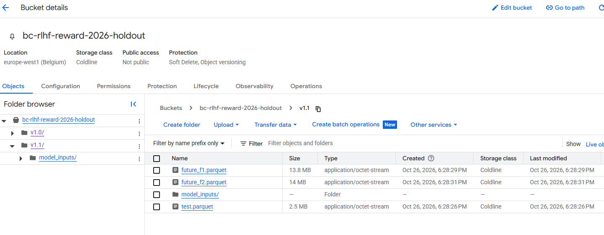
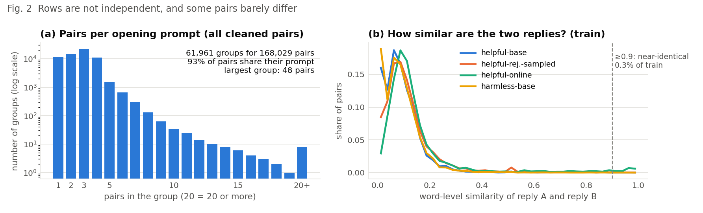
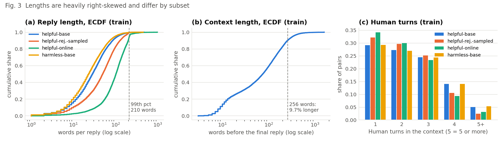
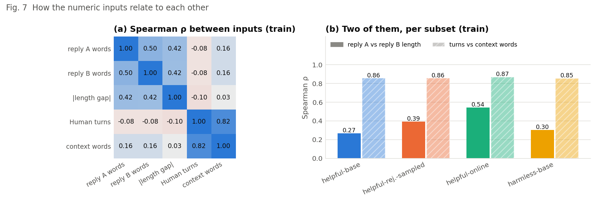

# 👍👎 Response Preference Prediction (RLHF Reward Modelling) — Milestone 2

This is Milestone 2 of my Data Handling and Infrastructure for AI project. It picks up where Milestone 1 left off, in [bounchun/rlhf-reward-model-pipeline-m1](https://github.com/bounchun/rlhf-reward-model-pipeline-m1) (release `data-v1.0`), and the full commit history came across with it, so you can trace how the project got from M1 to M2. This README is self-contained: you do not need the M1 report to follow it.


### M2.0 Project summary and Milestone 1 decisions

This project prepares the data for an RLHF reward model : given a conversation and two possible replies, predict which one the crowdworker preferred. In Milestone 1 I picked the dataset, decided how to split it and where to store it, and built a pipeline that downloads, cleans, splits and uploads the data to Google Cloud Storage (release data-v1.0). Milestone 2 starts from that working pipeline and adds to it: exploratory analysis, data contracts, a quarantine for bad rows, monitoring, and an independent check of the results. The table below lists the Milestone 1 decisions I kept. The ones I changed are in [M2.4](#m24-changes-since-v10-and-why).


| Decision | Summary |
|---|---|
| Data | [`Anthropic/hh-rlhf`](https://huggingface.co/datasets/Anthropic/hh-rlhf), MIT licence, pinned to commit `09be8c5bbc57cb3887f3a9732ad6aa7ec602a1fa` |
| Dataset version | v1.1 (M1 was v1.0). Raw data and split are unchanged. M2 adds new validation checks, moves failed rows into quarantine instead of dropping them, masks personal data, and produces inputs the model can use directly |
| Task and target | A yes/no prediction: `label` = 1 if reply A was the preferred one. The model sees the conversation and the two replies. Subset, split and the flags are only used to break down the results, never as inputs |
| Split | Pairs are grouped by their first Human message (hashed), so the same prompt never ends up in two splits. 20% of the groups are held back as "future" data (F1, F2). The remaining 30,002-pair working set is split 80/10/10 using `sha256(group_id + salt) % 10`. Anything learned from the data is fitted on train only |
| Storage | Google Cloud Storage rather than a database, because the data is written once in batches and training reads whole files, with no queries in between. There are two buckets: `gs://bc-rlhf-reward-2026` (Standard) and `gs://bc-rlhf-reward-2026-holdout` (Coldline, for test, F1 and F2). [M2.2](#m22-storage-implementation-and-evidence) shows how this was set up and what changed in M2 |
| Formats | Raw files stay as the original JSONL.gz. Processed data is Parquet, manifests are JSON, and audit files are CSV or JSON |
| Versioning | Each version gets its own `vMAJOR.MINOR` folder, a manifest and a Git tag (`data-v1.0`, now `data-v1.1`). The MINOR number goes up when the cleaning rules change |
| Bias and poisoning | The audit plan and the poisoning defences are in sections 11–12 of the [M1 README](https://github.com/bounchun/rlhf-reward-model-pipeline-m1). M2 adds the datasheet and the leakage audit |


## 🧭 Milestone 2 at a glance (dataset version v1.1)

| Milestone 2 requirement | Where it is |
|---|---|
| EDA that drives decisions | `src/eda.py` (run it with `make eda`) produces 9 figures, `docs/eda/eda_summary.json` and `docs/eda/findings.csv`, which links each finding to the decision it led to and its limits. The summary is in [M2.3](#m23-what-the-eda-found-and-what-it-changed) |
| Pipeline: acquire → validate → store → transform | Steps 1–11, all run by `make all`. The full pipeline is laid out in [M2.1](#m21-pipeline-architecture) |
| Storage implementation | Two GCS buckets, set up by a script and used by every step through the same few storage functions. The manifest records each stored file's location, SHA-256 and row count, and the files are checked again when read back from the bucket. See [M2.2](#m22-storage-implementation-and-evidence) |
| Validation that fails loudly | `src/contract.py` holds two data contracts. The raw one runs in step 3: any row that fails goes to a quarantine file with the reason, the source file and the line number. The processed one runs in step 9, checks 17 rules and logs the results to `audit/v1.1/validation_log.csv`. If a HARD rule fails, the pipeline stops before anything is uploaded |
| Cleaning and transformation | In step 3 the text gets normalised, PII is masked, and anything broken is quarantined (there are 7 reasons a row can end up there). Step 5 does the A/B swap and builds the features. Step 7 adds an outlier flag, using thresholds fitted on the training set only. Step 11 gets everything ready for the model: long contexts are cut from the left, and the log-length features are scaled with the training mean and standard deviation.|
| Second method / reconciliation | `src/reconcile.py` (run it with `make reconcile`) recounts everything straight from the raw files in plain Python, without using any pipeline code. All 7 of its checks have to match the pipeline's numbers |
| Reproducibility | The data commit and library versions are pinned and the splits are hash-based, so a rerun gives byte-identical output, and a test checks this. On every push, GitHub Actions runs the 43 tests and an offline demo (`.github/workflows/ci.yml`) |
| Changes since v1.0 | [M2.4](#m24-changes-since-v10-and-why) |
| Limitations and reflection | [M2.6](#m26-limitations-and-reflection) | 

### M2.1 Pipeline architecture

```text
make all  (Colab or locally · runs the steps in order, top to bottom,
│          and each step writes its log to manifests/v1.1.json).
│
├── 1 SOURCE  (one-off manual setup, not part of make all)
│   ├── Anthropic/hh-rlhf          Hugging Face, MIT licence, commit 09be8c5 pinned
│   │
│   └── setup_gcs.sh               creates 2 buckets (versioning + lifecycle),
│                                  2 service accounts: pipeline-sa writes, train-sa reads main only
│
├── 2 INGEST
│   ├── step1_scrape_raw           downloads the 8 raw files from Hugging Face over HTTPS
│   │                              (4 subsets: helpful-base, harmless-base, helpful-online,
│   │                              helpful-rejection-sampled; a train and a test file for each)
│   │                              ──▶ data/downloads/ (local), every file's SHA-256 checked
│   │                              against the hashes pinned in manifests/raw-<commit>.json
│   │                                   
│   └── step2_store_raw            uploads the 8 files to raw/ in the main bucket, reads each one
│                                  back and checks its SHA-256 again. raw/ is write-once: a file
│                                  that already exists is never overwritten
│                                  ──▶ gs://bc-rlhf-reward-2026/raw/hh-rlhf/<commit>/
│
├── 3 VALIDATE
│   ├── step3_clean                reads the raw files back from raw/ in the bucket, checks each
│   │                              row against the data contract and masks e-mails and phone numbers
│   │                              rejected rows (reason, file, line) ──▶ main: quarantine/v1.1/
│   │                              clean rows ──▶ data/interim/ (local, not uploaded yet)
│   │   
│   ├── step4_quality_checks       runs the hard checks (any failure stops the run), screens for
│   │                              data poisoning and checks that no e-mail or phone number is left
│   │                              report + flagged pairs ──▶ main bucket: audit/v1.1/
│   │
│   └╌╌ beam_validate              optional (make beam, not in make all): runs step 3's data
│                                  contract again with Apache Beam on this machine, checks
│                                  that every count matches step 3's
│
├── 4 TRANSFORM
│   ├── step5_features             gives each pair a prompt-group id (hash of first Human message),
│   │                              puts the preferred reply in A or B by hash so the label is 0 or 1,
│   │                              and adds reply lengths and refusal flags ──▶ data/interim/ (local) 
│   │ 
│   ├── step6_filter               sets aside 20% of the prompt groups as "future" data (F1, F2)
│   │                              and picks a 30,002-pair working set from the rest,
│   │                              taking whole prompt groups only ──▶ data/interim/ (local) 
│   │  
│   ├── step7_split                splits the working set 80/10/10 into train, dev and test by the
│   │                              hash of the prompt group, so a prompt never appears in 2 splits;
│   │                              flags very long replies, with the cut-off taken from train only
│   │                              ──▶ data/interim/ (local)
│   │  
│   └── step8_shard                off by default: the data is small enough that one file per split
│                                  is quicker to write and read than many shards 
│
├── 5 STORE
│   ├── step9_store_processed      checks every split against the 17-rule data contract first;
│   │                              if a HARD rule fails, the run stops and nothing is uploaded
│   │                              contract results ──▶ main bucket: audit/v1.1/validation_log.csv
│   │                              train, dev    ──▶ main bucket: processed/v1.1/
│   │                              test, F1, F2  ──▶ holdout bucket: v1.1/
│   │    
│   ├── step10_review_sample       picks 200 train pairs (spread across the 4 subsets) for me to
│   │                              label by hand, with crowdworker's choice hidden
│   │                              review sheet  ──▶ audit/label_review_v1.1.csv
│   │                                                (local only: it contains harmful text,
│   │                                                 so it is never uploaded or committed to Git)
│   │ 
│   └── step11_model_inputs        reads 5 splits back from the buckets and gets them ready for
│                                  the model: long contexts are cut from the left
│                                  (newest turns kept, max 256 words), the log lengths are scaled
│                                  with train's mean/standard deviation,
│                                  which are saved in numeric_scaler.json for M3
│                                  train, dev, scaler ▶ main bucket: processed/v1.1/model_inputs/
│                                  test, F1, F2 ──▶ holdout bucket: v1.1/model_inputs/
│
└── 6 CHECK
    ├── sample_queries             reads train and dev back from the main bucket and runs a few
    │                              example pandas queries on them, to check the stored data makes
    │                              sense (never reads the holdout bucket)
    │                              results ──▶ main bucket: audit/v1.1/sample_queries.json
    │    
    ├── reconcile                  recounts everything straight from the raw files in plain Python,
    │                              without the pipeline code, and reads the 5 stored splits back
    │                              from the buckets; all 7 checks must match the pipeline's numbers
    │                              results ──▶ main bucket: audit/v1.1/reconciliation.json
    │
    └── eda                        reads train, dev and the quarantine from the main bucket (never
                                   the holdout bucket) and turns them into 9 figures, a summary and
                                   a findings table linking each finding to a pipeline decision
                                   figures, eda_summary.json, findings.csv ─▶ GitHub: docs/eda/
                                   (aggregates only, no dataset text, so safe to commit)


gs://bc-rlhf-reward-2026           (main bucket · Standard storage· versioning on) 
├── raw/                           original Hugging Face files, never changed: if a cleaning
│                                  rule turns out to be wrong, I fix it and rerun from these
│                                    
├── quarantine/v1.1/               rows rejected by step 3, each with the reason and the file
│                                  and line it came from; kept instead of deleted
│  
├── processed/v1.1/                train.parquet and dev.parquet: cleaned, checked against 
│   │                              17-rule contract, ready for training (test stays in holdout bucket)
│   │
│   └── model_inputs/              train and dev ready for the model, plus numeric_scaler.json
│                                  (train mean/standard deviation) ──▶ what M3 trains on
│
├── audit/v1.1/                    the proof the data was checked: contract results (step 9),
│                                  quality report (step 4), sample queries and reconciliation
│
└── manifests/                     v1.1.json: what every step did (counts, settings, file hashes);
                                   a copy is committed to GitHub in manifests/

gs://bc-rlhf-reward-2026-holdout   (holdout bucket: Coldline storage, train-sa has no access)
└── v1.1/                          test, future_f1 and future_f2, plus their model_inputs/;
                                   read only once, for the final evaluation

```

**ETL rather than ELT.** All the transformations (parsing the conversations, swapping A and B, hashing the groups and masking personal data) are written in Python rather than SQL. The raw files only add up to 79 MB, so everything runs in a single Python process, which takes about 2½ minutes for steps 1 to 11. Only the cleaned Parquet files get loaded into storage for use. The raw files are still kept as they are, in a write-once, versioned bucket, so I can still do what ELT is good for: change a rule and rerun everything from the raw data. I looked at Apache Beam and Dataflow (Lecture 6), but at this size they would cost more and add extra setup for no real gain. The pipeline still uses the same ideas, though: every row is checked against a data contract, rejected rows go to quarantine with a reason, each step keeps counts, reruns give the same result, and an independent recount checks the final numbers.

### M2.2 Storage: implementation and evidence

Why object storage was chosen is summarised in [M2.0](#m20-project-summary-and-milestone-1-decisions). This section is about how it works in practice: how the storage is configured, how the data is organised and accessed, how each pipeline step uses them, and what I changed after Milestone 1. The buckets were created in Milestone 1. For v1.1 I kept them, added new folders and checks, and filled them with a full Colab run on 26 October 2026.


**How it is configured.** `scripts/setup_gcs.sh` creates both buckets in one go (cell 0b of the Colab notebook runs it too). Because the setup is a script rather than manual clicks in the console, anyone can repeat it exactly.


| Setting | Main bucket `gs://bc-rlhf-reward-2026` | Holdout bucket `gs://bc-rlhf-reward-2026-holdout` | Reason |
|---|---|---|---|
| Location | `europe-west1` (Belgium) | `europe-west1` | A single region near Dublin is enough. The data can be rebuilt from the raw files, so paying extra for multi-region copies isn’t worth it|
| Storage class | Standard | Coldline | Standard for data in daily use (train, dev); Coldline is cheaper for data kept aside and opened rarely (test, F1, F2) |
| Access control | Uniform bucket-level access, public access prevention on | Same | One set of IAM rules covers the whole bucket, so no single file can be shared by mistake; the harmful text in the data must never be public |
| Object versioning | On | On | A bad rerun or an accidental delete doesn’t lose data: the previous version is kept|
| Lifecycle (`scripts/gcs_lifecycle.json`) | Delete a non-current version when 4 newer ones exist or after 90 days | Same | Keeps recent versions for recovery but deletes older ones, so costs stay small |
| IAM | `pipeline-sa`: objectAdmin · `train-sa`: objectViewer | `pipeline-sa`: objectAdmin · `train-sa`: no role | The training account is given read access to train and dev only, and no access to the test set |


**How the data is organised.** Each dataset version has its own folders (`processed/v1.1/`, `quarantine/v1.1/`, `audit/v1.1/` and `v1.1/` in the holdout bucket). That way v1.0 and v1.1 can sit side by side, and a new version never overwrites an old one. Raw files are stored under the Hugging Face commit they came from (`raw/hh-rlhf/<commit>/<subset>/<split>.jsonl.gz`), so files from another version of the dataset can't get mixed in. The full layout is in the bucket tree in [M2.1](#m21-pipeline-architecture). The interim files (`data/interim/`) are never uploaded, because until the split is made they still contain the test rows.


**How it is accessed.** Every read and write goes through one small storage layer in `src/common.py` (`write_bytes`, `read_bytes`, `read_parquet` and `exists`), which uses `gcsfs` with Application Default Credentials (Google login in Colab). The bucket name is taken from the `DHAI_BUCKET` Colab Secret or environment variable, so it doesn't appear in the code or in `config.json`, and there is no service account key file anywhere. If `DHAI_BUCKET` is left empty, the same code writes to `data/lake/` and `data/holdout/` on disk instead. That is how CI (Continuous Integration) runs the 43 tests and the offline demo without a Google Cloud account. 


**How it fits into the pipeline.** Storage isn't just where the data ends up. Several later steps read their input back from the buckets, so they work on exactly what was stored rather than on a local copy that might differ.  


| Step | Reads | Writes | Storage check |
|---|---|---|---|
| 2. Store raw | local downloads | `raw/hh-rlhf/<commit>/…` | Each file's SHA-256 is checked before upload, and again after reading it back; `raw/` is write-once, so a file with different content stops the run |
| 3. Clean | `raw/` from the bucket | `quarantine/v1.1/quarantine.parquet` | Each raw file’s SHA-256 is checked again before any row is read | 
| 4. Quality checks | local cleaned data | `audit/v1.1/` | — |
| 9. Store processed | local splits | `processed/v1.1/{train,dev}`; holdout `v1.1/{test,future_f1,future_f2}` | Every split is checked against the 17-rule contract before upload; if a HARD rule fails, no split is uploaded (only the contract log, to show what failed). Each stored file's location (URI), hash, size (bytes) and row count are saved in the manifest |
| 11. Model inputs | all 5 splits from the buckets | `processed/v1.1/model_inputs/` and holdout `v1.1/model_inputs/` | The scaling uses the train mean and standard deviation only, saved in `numeric_scaler.json` so every split is scaled the same way |
| Sample queries, EDA | train/dev and quarantine from the main bucket (EDA also uses the local cleaned data) | `audit/v1.1/`, `docs/eda/` | Never read the holdout bucket |
| Reconcile | `raw/` and all 5 stored splits from the buckets | `audit/v1.1/reconciliation.json` | Stored files must match the manifest's SHA-256 and row counts |

**Evidence.**

- **The manifest.** `manifests/v1.1.json`, with a copy in `gs://bc-rlhf-reward-2026/manifests/`, lists every stored file with its `gs://` location, SHA-256 hash, size and row count. For example, `gs://bc-rlhf-reward-2026/processed/v1.1/train.parquet` has 24,122 rows (20.1 MB), and `gs://bc-rlhf-reward-2026-holdout/v1.1/test.parquet` has 3,004 rows.
- **The reconciliation.** It reads the five splits back from the buckets: all SHA-256 hashes and row counts match the manifest.
- **The Colab notebook.** The "Verify the buckets and read a file back" cell lists the contents of both buckets and loads `dev.parquet` directly from GCS (`Rows loaded: 2,876`).
  
- Screenshots of the main bucket settings and of the four v1.1 folders after the run:

*Main bucket settings: region, uniform access, public access prevention, versioning, 2 lifecycle rules*


*(a) Main bucket, `processed/v1.1/`*


*(b) Main bucket, `quarantine/v1.1/`*


*(c) Main bucket, `audit/v1.1/` (with `validation_log.csv` and `reconciliation.json`)*


*(d) Holdout bucket (Coldline), `v1.1/`*





**What changed after Milestone 1.** The bucket design (two buckets, storage classes, versioning, IAM roles) is unchanged, since the v1.0 run showed it worked well. What changed is how the pipeline uses the buckets: 

| New in M2 | Reason |
|---|---|
| New `quarantine/<version>/` folder | Rejected rows are kept with reason, source file and line number, instead of being dropped |
| New `audit/<version>/` folder with `validation_log.csv` and `reconciliation.json` | The proof that the data was checked is stored next to the data |
| Processed data contract runs before upload | A split that fails validation is never uploaded to the bucket |
| New `model_inputs/` in both buckets, with the train-fitted scaler | Milestone 3 reads ready-to-use inputs; the test inputs stay in the holdout bucket |
| Step 11, the EDA and the reconciliation read from the buckets | Later stages and validations run against what was actually saved to the bucket| 

### M2.3 What the EDA found, and what it changed

All numbers come from `make eda` on the real data (`docs/eda/eda_summary.json`). Structure and quality checks cover every row; distribution and relationship analyses use the training split only; baselines are trained on train and evaluated on dev; and the holdout bucket is never accessed. 

| # | Finding (real data, v1.1) | Decision in the pipeline |
|---|---|---|
| 1 | In the raw files the preferred reply is always in the `chosen` column: a model could score 100% by learning the column| Replies are swapped into A/B positions based on `hash(pair_id)`, so the preferred reply is now A in 49.8% of train pairs |
| 2 | 1,323 of the 169,352 raw pairs break at least one rule, and the failure rate varies by subset: 13.0 per 1,000 in helpful-rejection-sampled vs 4.7 in harmless-base (χ² p = 6e-65, Cramér's V = 0.04). So the problems are not "missing completely at random" (MCAR) | Failing rows go to a quarantine with their reason and source line rather than being dropped, and the pipeline asserts `rows_read = kept + quarantined` (fig. 1) |
| 3 | 93% of pairs share their opening prompt with another pair, and 92% of official test pairs reuse a prompt from the official train split | Justifies the M1 group split; contract rule "no `group_id` in two splits" (fig. 2) |
| 4 | Reply length is right-skewed (skew 2.0, falling to −0.4 after `log1p`), and the usual 1.5×IQR rule would mark 5% of replies as outliers | Replies longer than the train 99th percentile (210 words) are flagged, not deleted; step 11 uses `log1p` lengths (fig. 3) |
| 5 | 9.7% of train contexts exceed 256 words | Step 11 cuts long contexts from the left, keeping the most recent turns, and marks each cut row with `context_truncated` |
| 6 | The preferred reply is the longer one in 58% of helpful-base pairs but in only 42% of harmless-base pairs; pooled together (52%), the two effects cancel out (Cramér's V = 0.14) | Length is a shortcut that depends on the subset: M3 reports accuracy per subset and per length-gap slice (fig. 4) |
| 7 | A length-only model gets 51.4% on dev when pooled, but 58.2% when a separate length model is fitted for each subset | These are the baselines the M3 reward model must beat on every subset (fig. 5) |
| 8 | 47% of replies use the curly apostrophe ’, so the v1.0 refusal regex (straight `'` only) flagged only 0.09% of pairs | Refusal phrases rebuilt from the data to match both apostrophes: 2.2% now flagged |
| 9 | When only one of the two replies is a refusal, the refusal is preferred in 75% of harmless-base pairs but in only 27% of helpful-base pairs | A second shortcut that depends on the subset, so M3 reports a refusal slice for each subset (fig. 6) |
| 10 | Some inputs are strongly correlated: the lengths of reply A and reply B have ρ = 0.50 pooled and 0.27–0.54 within subsets (partly because the subsets differ in typical reply length), and the number of turns and the context length in words have ρ = 0.82 | Linear baselines use the log length ratio instead of the two lengths; since part of the A–B correlation comes from the subsets, this is another reason to evaluate per subset (fig. 7) |
| 11 | Rows are clustered in prompt groups, so confidence intervals were recomputed with a group bootstrap that resamples whole prompt groups rather than single rows. The design effect is small (1.07–1.15). The gap in length preference between helpful-base and harmless-base is 16.1 points (95% CI 14.3–17.8), the length effect holds on held-out dev in all 4 subsets, and all 4 tests remain significant after Benjamini–Hochberg correction | M3 reports group-bootstrap intervals. Per-subset test accuracy is only precise to about ±3–5 points, so differences smaller than that will not be claimed (fig. 8) |
| 12 | Two scikit-learn Pipelines (a ColumnTransformer model on length × subset, and a bag-of-words model whose vocabulary is learned inside each fold) give the same accuracy with random-row folds as with `GroupKFold` on prompt groups (gap ≤ 0.2 points), though the group folds vary between folds | M3 uses GroupKFold for all cross-validation, and bag of words (54.8% on dev) becomes the first text baseline. Random-row folds show no measurable inflation for these reply-only models, which does not prove there is no leakage: a model that also reads the prompt could still memorise it (fig. 9) |
| 13 | 304 pairs contain an e-mail address and 724 contain something that looks like a phone number | Masked as `[EMAIL]` / `[PHONE]`; step 4 checks that none is left |

#### Figures

All 9 figures are produced by `make eda` and saved in [`docs/eda/`](docs/eda/). They use train only, except fig. 5 and the dev replication in fig. 8. The numbers in each caption match the table above.

<p align="center">
  <br>
  <em><b>Figure 1.</b> Quarantine rate by subset: 13.0 per 1,000 pairs in helpful-rejection-sampled vs 4.7 in harmless-base (χ² p = 6e-65, Cramér's V = 0.04), so the failures are not MCAR (finding 2).</em>
</p>

<p align="center">
  <br>
  <em><b>Figure 2.</b> 93% of pairs share their opening prompt with another pair, and 0.2% of train pairs have near-identical replies (similarity ≥ 0.9) (finding 3).</em>
</p>

<p align="center">
  <br>
  <em><b>Figure 3.</b> Reply length is right-skewed (skew 2.0, falling to −0.4 after <code>log1p</code>). Replies above the train 99th percentile (210 words) are flagged, not deleted (finding 4).</em>
</p>

<p align="center">
  <br>
  <em><b>Figure 4.</b> The longer reply is preferred in 58% of helpful-base pairs but only 42% of harmless-base pairs, so the pooled 52% hides two opposite effects (finding 6).</em>
</p>

<p align="center">
  <br>
  <em><b>Figure 5.</b> On dev, a length-only model scores 51.4% pooled but 58.2% with one model per subset (the constant baseline scores 48.3%) (finding 7).</em>
</p>

<p align="center">
  <br>
  <em><b>Figure 6.</b> When only one reply is a refusal, it is preferred in 75% of harmless-base pairs but only 27% of helpful-base pairs (finding 9).</em>
</p>

<p align="center">
  <br>
  <em><b>Figure 7.</b> Spearman correlations between inputs: reply A vs reply B length ρ = 0.50, number of turns vs context words ρ = 0.82 (finding 10).</em>
</p>

<p align="center">
  <br>
  <em><b>Figure 8.</b> With a group bootstrap, the length-preference gap between helpful-base and harmless-base is 16.1 points (95% CI 14.3–17.8), and the effect replicates on dev in all 4 subsets (finding 11).</em>
</p>

<p align="center">
  <br>
  <em><b>Figure 9.</b> Random-row and prompt-group 5-fold CV agree within 0.2 points for both models, but the group folds vary more from fold to fold (finding 12).</em>
</p>


### Six qualities of a trustworthy pipeline
 
| Quality | How it is built into this pipeline |
|---|---|
| Repeatable | The data commit and library versions are pinned and the splits are hash-based. A full rerun reproduces the Parquet files and EDA figures byte for byte |
| Idempotent | Each output file is overwritten in full on every run (like `WRITE_TRUNCATE`), never appended to; `raw/` is write-once and rejects any file whose bytes differ from the original |
| Observable | Every step prints its counters and saves them in the manifest; rejected rows are quarantined with their reasons; each file's quarantine rate and JSON-field fingerprint are tracked, with alerts for unusual rates or schema drift (fields renamed, added, removed or changing type) |
| Testable | 43 unit tests run on synthetic data with deliberately planted defects, and GitHub Actions runs them on every push |
| Fails loudly | The run stops on a checksum mismatch, a row-accounting gap (`rows read ≠ kept + quarantined`, i.e. rows lost without a trace), a HARD contract violation, a reconciliation disagreement or, optionally , an alert |
| Cost-aware | One Python process instead of Dataflow workers (see *ETL rather than ELT* in [M2.1](#m21-pipeline-architecture)); Colab and CI are free; the buckets hold only a few hundred MB and use lifecycle rules to limit storage costs |


**Apache Beam (optional, `make beam`).** `src/beam_validate.py` re-implements step 3's data contract as a Beam pipeline. It uses a `DoFn` to read the files, a `Validate` `DoFn` that sends failing rows to a tagged `bad` output, Beam `Metrics` counters, and a `CombinePerKey` to detect duplicates. Every counter is then compared with the pandas version of step 3, and on the real data all 10 counts match (169,352 read, 168,029 kept, 1,323 quarantined, broken down by reason). This cross-check proved its worth early: in the first version, Beam's built-in `.gz` reader returned only 44,044 rows, and the count mismatch revealed the problem immediately. Running the pipeline on Dataflow is planned but not implemented. The code relies only on portable Beam transforms, so it should run with `--runner DataflowRunner` and `apache-beam[gcp]`, but this has not been tested (see *ETL rather than ELT* in [M2.1](#m21-pipeline-architecture) for why).


### From EDA findings to pipeline rules and tests

| Finding or principle | Evidence in EDA | Pipeline rule | Test that guards it |
|---|---|---|---|
| Repeated prompts make rows dependent on each other | 93% of pairs share a prompt with another pair; 92% of official test pairs reuse a prompt from the official train split | Split by prompt group; confidence intervals use a group bootstrap | `test_no_group_or_pair_overlap_between_any_splits`, contract rule "no group_id in two splits" |
| A significant result is not necessarily a large effect | Each χ² p-value is shown with its Cramér's V, and the 16.1-point risk difference comes with a confidence interval | Every test reports an effect size and an interval, not just a p-value | `test_group_bootstrap_widens_intervals_for_clustered_rows`, `test_benjamini_hochberg` |
| Pooling the data can hide effects that differ by subset (Simpson's paradox) | The length and refusal effects point in opposite directions in different subsets | Baselines are computed per subset, and the evaluation slices are fixed in advance in `config.json` | `test_eda_writes_figures_and_findings_without_reading_the_holdout` |
| Outliers should be investigated before being removed | The 1.5×IQR rule would flag 5% of replies that are actually valid | Replies above the train 99th percentile are flagged, not removed; length features use `log1p` | `test_outlier_threshold_fitted_on_train_only` |
| Preprocessing must never learn from held-out data | The scaler, the outlier threshold and the TF-IDF vocabulary (word weights based on frequency in a reply and rarity across replies) are fitted on train, or on the training folds in cross-validation | Step 11 uses a scaler fitted on train only; cross-validation uses `GroupKFold` | `test_scaler_is_fitted_on_train_only`, `test_text_features_are_learned_on_the_training_fold_only` |
| Invalid data must remain traceable, not disappear | 1,323 rows break a rule, at different rates in each subset | Rejected rows are quarantined with their reason, and every row read must be either kept or quarantined | `test_every_row_read_is_kept_or_quarantined`, `test_processed_contract_catches_a_corrupted_copy` |
| A pipeline must give the same result when rerun and detect changes in the data's structure | All 8 raw files have the same fields; the highest reject rate in any file is 1.3% | Outputs are overwritten in full, `raw/` is write-once, and each file's field fingerprint and reject rate trigger alerts if they change | `test_rerun_is_byte_identical`, `test_alerts_for_schema_drift_and_reject_spike` |
| Results are only trustworthy if checked by an independent method | The first Beam version read only 44,044 of the 169,352 rows, and comparing it with pandas exposed the bug | 7 reconciliation checks recount everything from the raw files; Beam and pandas counts must match | `test_reconciliation_catches_a_flipped_label`, `test_beam_pipeline_agrees_with_pandas_step3` |


### Leakage audit (Kapoor & Narayanan, 2023)

| Leakage type | How this project handles it |
|---|---|
| L1.1 No test set | The test set is made of held-out prompt groups and stored in a separate bucket that the training account has no permission to read |
| L1.2 Pre-processing on train and test | The outlier threshold, the scaler and the refusal phrases are all learned from train only, verified by tests |
| L1.3 Feature selection on train and test | No feature selection is done; the evaluation slices are fixed in `config.json` before the test set is used |
| L1.4 Duplicates | Exact duplicates are sent to quarantine; the data contract fails the run if a `pair_id` appears in two splits; no comparison appears twice |
| L2 Illegitimate features | The A/B swap removes the clue given by the `chosen` position; `subset`, `split` and the flags are used only to break down the evaluation, never as model inputs |
| L3.1 Temporal leakage | The dataset has no timestamps, so F1 and F2 are held-out prompt groups, not genuinely later data (see Limitations) |
| L3.2 Non-independence between train and test | Data is split by prompt group, so no prompt appears in both train and test; the official split would have put 92% of test prompts in train as well |
| L3.3 Sampling bias in the test distribution | The test set is sampled the same way as train (same mix of subsets), so it reflects how this dataset was collected, not how real users would behave |

The dataset itself is documented in **[`docs/DATASHEET.md`](docs/DATASHEET.md)**, following Gebru et al. (2021).

### M2.4 Changes since v1.0, and why

The data split is unchanged (same salts), and so are the two buckets and their access rules; how the pipeline uses the storage was refined (see [M2.2](#m22-storage-implementation-and-evidence)). v1.1 is a MINOR version (M1 versioning rule: cleaning rules changed, split unchanged), and the run confirms it: train / dev / test / F1 / F2 have exactly the same sizes, groups and label shares as v1.0.

| What changed | Reason |
|---|---|
| How the pipeline uses storage (new folders, contract checked before upload, later steps read back from the buckets); details in [M2.2](#m22-storage-implementation-and-evidence) | M2 asks for storage that supports the whole pipeline, not only a place to put the final files |
| Quarantine instead of dropping rows (`quarantine/v1.1/quarantine.parquet`) | Every rejected row keeps its reason, file and line number |
| Processed data contract + `validation_log.csv` | Record the rule, its rationale and the number of violations; stop before upload on a HARD violation |
| PII masking in step 3 (new reason `identical_after_pii_mask`: 1 pair) | Governance: the data should not carry e-mails or phone numbers; ids are computed before masking so pair ids and splits do not move |
| Refusal phrases rebuilt | Planned in the M1 README and confirmed by the EDA | 
| Step 11 model-ready inputs | Fit on train, transform every split; prepares M3 |
| `reconcile.py`, `eda.py`, CI workflow | Evidence that the pipeline is correct and reproducible |


### M2.5 v1.1 run on the real data

| Check | Result |
|---|---|
| Raw input | All 8 files have SHA-256 checksums that match the ones pinned in `manifests/raw-09be8c5….json` |
| Row accounting (step 3) | All 169,352 rows read are accounted for: 168,029 kept and 1,323 quarantined (788 with identical replies, 329 with a context mismatch, 194 with an empty reply, 11 with malformed turns and 1 that became identical after PII masking) |
| Quality checks (step 4) | All 6 hard checks pass, no e-mail or phone patterns remain, and the poisoning screen flags no pairs |
| Splits (step 7) | Train 24,122, dev 2,876, test 3,004, F1 16,516 and F2 16,652 pairs –  identical to v1.0 |
| Data contract (step 9) | All 17 rules checked on each of the 5 splits, with no violations and no warnings |
| Model inputs (step 11) | The scaler is fitted on the 24,122 train rows; 9.7% of train contexts and 8.3% of dev contexts are truncated |
| Reconciliation | All 7 independent checks match the pipeline's numbers |
| EDA | 9 figures and 13 findings, saved in `docs/eda/` |
| Cross-validation | Length × subset model (ColumnTransformer pipeline): 56.9% with random-row folds vs 56.7% with group 5-fold CV, and 57.9% on dev. Bag of words: 54.9% with both fold types, and 54.8% on dev |
| Storage (Colab run, 26 Oct 2026) | Train, dev, their model inputs, the quarantine and the audit files are stored in `gs://bc-rlhf-reward-2026` (Standard); test, F1, F2 and their model inputs are stored only in `gs://bc-rlhf-reward-2026-holdout` (Coldline). Every stored file was read back and matched against the manifest, which is committed as `manifests/v1.1.json` with the tag `data-v1.1`. Screenshots are in [M2.2](#m22-storage-implementation-and-evidence) |


### M2.6 Limitations and reflection

**Limitations**

| Limitation | Impact | How to address it |
|---|---|---| 
| The Colab run used my personal Google account instead of `pipeline-sa` | The service-account roles exist but were never used, so the rule "the training account cannot read the holdout bucket" is configured but unverified | In M3, run the pipeline and a training read as the service accounts (via impersonation) and record the expected `403` on the holdout bucket |
| Each pair has a single, noisy label (about 63% researcher agreement) | Caps the accuracy any model can reach; some apparent model errors will really be label errors | Use the 200-pair review sheet to estimate how noisy the labels are |
| hh-rlhf has no timestamps | F1 and F2 are held-out prompt groups rather than data collected later, so they cannot measure drift over time | Use a preference dataset that records when each pair was collected |
| The test set reflects how this data was collected (crowdworker prompts) | Results describe crowdworker conversations on these four subsets, not real users | Evaluate on a preference set collected in a different way |
| Test accuracy for each subset is only precise to about ±3–5 points | Small differences between subsets are not reliable enough to report | Report group-bootstrap confidence intervals and only claim differences larger than them |
| PII masking only catches fixed patterns (e-mail, phone numbers) | Names, addresses, other personal details written in free text stay unmasked | Add a PII detector based on named-entity recognition |
| Processing runs on a single machine; the Beam job was never run on Dataflow | Works for 79 MB of data, but larger volumes are untested |  Run `beam_validate.py` with `DataflowRunner` if the data grows |
| There is no `models/` folder yet | Trained models are not yet stored or versioned | In M3, add `models/` to the main bucket and version it the same way as the data |

**Reflection**

- **Implementing storage early paid off:** because the buckets worked after M1, M2 could focus on how the pipeline uses them (checking before upload, keeping rejected rows, reading files back to verify them). Most of the trust in the data now comes from these checks rather than from the bucket itself.
- **EDA changed the pipeline, not just the report:** three issues found in the data (the label that always pointed to `chosen`, the curly apostrophe that broke the refusal rule, and the length effect that varied by subset) each led to a code change and a new test.
- **Independent checks caught a real bug:** comparing the pandas output with Beam revealed a multi-member gzip reading bug that made Beam read only 44,044 of the 169,352 rows, something the pandas pipeline alone would never have shown. Next time I would build the reconciliation first, not last.
- **Keeping claims precise:** reviewing the draft showed some wording that went further than the evidence ("no leakage", "Dataflow-ready"). These now read "no measurable inflation for these models" and "planned, not implemented".
- **M3 goals:** train the model on `model_inputs/`, beat the per-subset length baseline on every subset, report group-bootstrap confidence intervals, and verify that the service accounts are properly separated.

### M2.7 Plan for Milestone 3

**First model.** A small pretrained transformer encoder (512 tokens) used as a reward model: it gives each reply its own score from the context plus that reply (`text_a`, `text_b` from step 11), and is trained with a pairwise loss so that the preferred reply scores higher. Scoring each reply on its own, rather than classifying A vs B, means the same model can later rank any number of replies. It must beat these baselines from M2 (dev accuracy):

| Baseline | Dev accuracy |
|---|---|
| Constant (train majority class) | 48.3% |
| Length only, pooled | 51.4% |
| Bag of words (reply A − reply B) | 54.8% |
| Length × subset, one model per subset | 58.2% (the one to beat) |

**How it will be evaluated**

- **Data use:** train on `train`, choose settings on `dev` with `GroupKFold` on prompt groups, and score `test` only once, at the end. F1 is used as an extra "new prompts" check.
- **Per subset, never pooled alone:** length and refusal push in opposite directions in helpful-base and harmless-base (findings 6 and 9), so a pooled score can hide a failure on one subset.
- **Slices fixed in `config.json` before testing:** length gap between the replies, pairs where only one reply is a refusal, near-identical replies, and truncated contexts.
- **Group-bootstrap 95% intervals** (resampling prompt groups). The model counts as beating a baseline on a subset only if its interval lies above the baseline.
- **Label-noise ceiling:** the 200-pair review sheet from step 10 estimates how often the labels themselves are wrong, so accuracy is judged against that ceiling, not against 100%.

**MLOps**

| Need | Plan |
|---|---|
| Experiment tracking | Every run logs the data version (`data-v1.1`), the Git commit, the full config, the random seed and the metrics per subset and slice, with MLflow |
| Versioned models | A new `models/<model-version>/` folder in the main bucket holds the weights, a manifest (SHA-256, data version, commit, metrics) and a short model card, versioned like the data |
| Access | Training runs as `train-sa`, which can read `processed/` but not the holdout bucket; the final test is a separate step. This also tests the service-account separation that M2 configured but did not verify (M2.6) |
| Retraining trigger | Retrain when a new data version is released (MINOR or MAJOR bump), when the monitoring alerts in step 3 fire, or when accuracy on new held-out prompts (F2) falls below the per-subset length baseline |
| Reproducibility | Pinned libraries and seeds, tests for the training code in CI, and a Colab notebook that runs training end to end |


## ▶️ How to run it

**Option 1: quick check, no account needed (about 1 minute).** Open a new notebook at [colab.research.google.com](https://colab.research.google.com), paste this into one cell and run it:

```python
!git clone https://github.com/bounchun/rlhf-reward-model-pipeline-m2.git repo
%cd repo
!pip install -q -r requirements.txt
!make test
!DHAI_BUCKET= make demo && echo "demo OK"
```

It should end with `OK` (43 tests passed; the Apache Beam test runs when `requirements-beam.txt` is installed, as in CI) and `demo OK` (the whole pipeline, steps 1–11, the reconciliation and the EDA, run on fake data with planted problems). Nothing touches Google Cloud. The same two commands run on every push in GitHub Actions.

**Option 2: the full pipeline on the real data.** [](https://colab.research.google.com/github/bounchun/rlhf-reward-model-pipeline-m2/blob/main/notebooks/run_pipeline_colab.ipynb)
1. Click the badge, then File → Save a copy in Drive.
2. Add a Colab Secret (🔑 in the left sidebar): name `DHAI_BUCKET`, value = the name of a bucket in your own Google Cloud project, with notebook access switched on.
3. In the first code cell, set `GCP_PROJECT` to your project ID.
4. Run the cells from top to bottom. Run 0b once to create your buckets (skip it if they already exist from Milestone 1), and skip the cells marked *skip*.

The run takes about 5–10 minutes and gives the same numbers as in [M2.5](#m25-v11-run-on-the-real-data), because the split uses hashes, not random numbers. The EDA cells show the 9 figures inline, and the cell after them downloads `docs/eda/` and `manifests/v1.1.json` to commit. This is a new notebook for Milestone 2 only; the Milestone 1 notebook stays in the M1 repository.

To check the stored data without rerunning the pipeline, run only Settings, Install and Login, then the Verify the buckets and read a file back cell. Like Cell 8 of the GCS lab, it lists every file in both buckets and reads `dev.parquet` straight from the bucket with pandas. You should see the raw, quarantine, processed, audit and manifest files in the main bucket, only `test`, `future_f1`, `future_f2` and their `model_inputs` in the holdout bucket, and `Rows loaded: 2,876`. It shows only non-text columns, because the dataset contains harmful text.

**Option 3: on your own machine** (Python 3.13):
```bash
git clone https://github.com/bounchun/rlhf-reward-model-pipeline-m2 && cd rlhf-reward-model-pipeline-m2
pip install -r requirements.txt
make test && make demo                    # offline check
export DHAI_BUCKET=<your-bucket> && make all   # full run (steps 1-11, reconcile, eda), needs Google Cloud
DHAI_BUCKET= make all                          # or: full run with local folders instead of buckets
```

---

## 🛠️ Repository layout and pipeline steps

One Python script per step; each script says at the top what it reads, writes and checks, and each run records its row counts, settings and checksums in `manifests/<version>.json`. `make all` runs steps 1–11, then the sample queries, the reconciliation and the EDA in order.

| Step | Script (`src/`) | Input → output |
|---|---|---|
| 1. Acquire | `step1_scrape_raw.py` | Downloaded from Hugging Face at a pinned commit; a failed download is retried, with a longer wait before each attempt (backoff) → saved to `data/downloads/`, logged in `manifests/raw-<rev>.json` |
| 2. Store raw | `step2_store_raw.py` | Uploads the raw files to `gs://bc-rlhf-reward-2026/raw/`; each file is written once and never overwritten, then read back and checked against its checksum |
| 3. Validate + clean | `step3_clean.py`, `contract.py` | Reads the raw files and writes valid rows to `cleaned.parquet`; rows that fail a check go to a quarantine file with the reason they failed. Every input row is accounted for (kept + quarantined = total), personal details are masked, and an alert is raised if the schema changes or the reject rate gets too high |
| 4. Quality checks | `step4_quality_checks.py` | Runs hard checks that stop the pipeline if they fail, screens the data for signs of poisoning (deliberately misleading or manipulated pairs), and searches for any personal details the masking missed; results saved to `audit/<version>/` |
| 5. Features | `step5_features.py` | Builds the group key for each pair (a hash of the normalised first Human message, so related pairs stay in the same split); places the chosen reply in position A or B by a seeded swap and records which in `label`, so the answer is not always the same position; and adds response lengths and refusal flags |
| 6. Filter | `step6_filter.py` | Sets aside 20% of the prompt groups as a future reserve (F1, F2), then takes a 30,002-pair working set made of whole prompt groups, keeping the original mix of subsets |
| 7. Split | `step7_split.py` | Splits the working set 80/10/10 into train/dev/test using a hash of each prompt group, so related pairs always land in the same split; the outlier threshold is learned from the training set only, so dev and test stay unseen |
| 8. Shard | `step8_shard.py` | Optional, off by default: splits the output into smaller files (shards) so larger datasets can be processed in parallel; not needed at the current 79 MB |
| 9. Store processed | `step9_store_processed.py`, `contract.py` | Checks the processed data against a 17-rule data contract and logs each result in `validation_log.csv`; only after it passes are the Parquet files uploaded to `processed/` and the held-out data to the separate holdout bucket |
| 10. Review sheet | `step10_review_sample.py`, `score_review.py` | Draws 200 pairs for a blind review, where the reviewer picks the better reply without seeing the original label; `score_review.py` then measures how often the reviewer agrees with the dataset label, to estimate label noise |
| 11. Model inputs | `step11_model_inputs.py` | Writes the final, ready-to-train files to `model_inputs/` for every split; the feature scaler is learned from the training set only and then applied unchanged to dev, test and the reserve |
| Check | `reconcile.py` | Recounts everything independently, starting again from the raw files, and compares the result with the pipeline's output in 7 checks; any mismatch shows a bug in one of the two |
| Check (optional) | `beam_validate.py` | Runs step 3's data contract a second time on Apache Beam and compares the results with the pandas pipeline; run it with `make beam` |
| EDA | `eda.py` | Explores the cleaned data and saves the results to `docs/eda/`: 9 figures, summary statistics in `eda_summary.json`, and the list of findings in `findings.csv` |
| Queries | `sample_queries.py` | Runs example pandas queries on the train and dev data read back from storage, showing that the stored files can be loaded and queried as expected |


| Path | Purpose |
|---|---|
| `config.json` | All pipeline settings in one file: Hugging Face revision, hashing salts, split buckets, thresholds, alert limits, EDA settings |
| `requirements.txt` | Pinned package versions for Python 3.13 (optional Apache Beam dependencies in `requirements-beam.txt`) |
| `Makefile` | `make all` \| `scrape` \| `store` \| `preprocess` \| `queries` \| `reconcile` \| `eda` \| `beam` \| `test` \| `demo` |
| `src/` | The step scripts above, plus `common.py` (storage, hashing, manifests) and `text_utils.py` (text processing) |
| `tests/` | 43 `unittest` tests on synthetic data with deliberately planted errors (generated by `tests/fake_data.py`) |
| `notebooks/run_pipeline_colab.ipynb` | Runs the full M2 pipeline in Colab: steps 1–11, reconciliation, EDA figures. Uses Google login and a Colab Secret, so no credentials are stored in code |
| `manifests/` | Dataset manifests recording lineage: file checksums, row counts and code commit that produced each version |
| `docs/eda/` | EDA outputs: summary statistics and figures only, no text from dataset |
| `docs/DATASHEET.md` | Datasheet for the processed v1.1 dataset: what it contains, how it was built and its known limitations (Gebru et al., 2021) |
| `docs/architecture_m2.html` | Source file for the architecture diagram (`docs/img/architecture_m2.png`) |
| `docs/img/m2_bucket*_v1.1.png` | Bucket screenshots after v1.1 Colab run |
| `scripts/setup_gcs.sh` | Run once to create GCS buckets and set IAM permissions (carried over from M1) |
| `.github/workflows/ci.yml` | GitHub Actions workflow: runs the tests and an offline demo on every push |

                            


Interim files (`data/interim/`) stay local and are never committed: until the split, it still contains test rows.

---

## 📚 References used in M2

- Bai, Y. et al. (2022). [*Training a Helpful and Harmless Assistant with RLHF*](https://arxiv.org/abs/2204.05862).
- Gebru, T. et al. (2021). [*Datasheets for Datasets*](https://arxiv.org/abs/1803.09010). Communications of the ACM, 64(12).
- Kapoor, S. and Narayanan, A. (2023). [*Leakage and the reproducibility crisis in ML-based science*](https://doi.org/10.1016/j.patter.2023.100804). Patterns, 4(9).
- Anscombe, F. J. (1973). Graphs in statistical analysis. *The American Statistician*, 27(1).
- Tukey, J. W. (1977). *Exploratory Data Analysis*. Addison-Wesley.
- Schutt, R. and O'Neil, C. (2013). *Doing Data Science*, ch. 2. O'Reilly.
- scikit-learn: [Common pitfalls and recommended practices](https://scikit-learn.org/stable/common_pitfalls.html).
- [Apache Beam programming guide](https://beam.apache.org/documentation/programming-guide/).
- Wahid, A. (2026). *Data Handling and Infrastructure for AI*, Lectures 4–6 and Labs 4–6, SETU.
- Rando, J. and Tramèr, F. (2024). [*Universal Jailbreak Backdoors from Poisoned Human Feedback*](https://arxiv.org/abs/2311.14455). ICLR.

---

## 🤖 Use of AI

**Tool used**

- Claude (Anthropic) and ChatGPT (OpenAI) 

**How I worked with it**

| Part of the work | My role | How AI helped |
| --- | --- | --- |
| Debugging | Ran the pipeline, fixed the problems in my Colab run and reran it until every check passed | Helped find the causes (for example Beam's `.gz` reader returning only 44,044 rows) and suggested fixes |
| Google Cloud | Set up and ran the v1.1 pipeline on my own GCP project and buckets on 26 October 2026, and took the screenshots | Step-by-step guidance |
| Report, README and datasheet | Checked every number against my Colab run and `manifests/v1.1.json` | Suggested shorter wording, fixed Markdown tables and wrote figure captions |
| Language | — | Grammar and spelling |

All numbers in this README come from my own pipeline run on 26 October 2026, recorded in `manifests/v1.1.json` and `docs/eda/eda_summary.json`, not from the AI.

**Example prompts**

1. *"Fix the formatting problem in markdown."* (followed by a broken table)
2. *"Write the figures block for M2.3, with all nine figures and a one-line caption for each from `findings.csv`."*
3. *"Give me my real project ID."*

---

## 💻 Author

**Boun Chun** · [@bounchun](https://github.com/bounchun)
