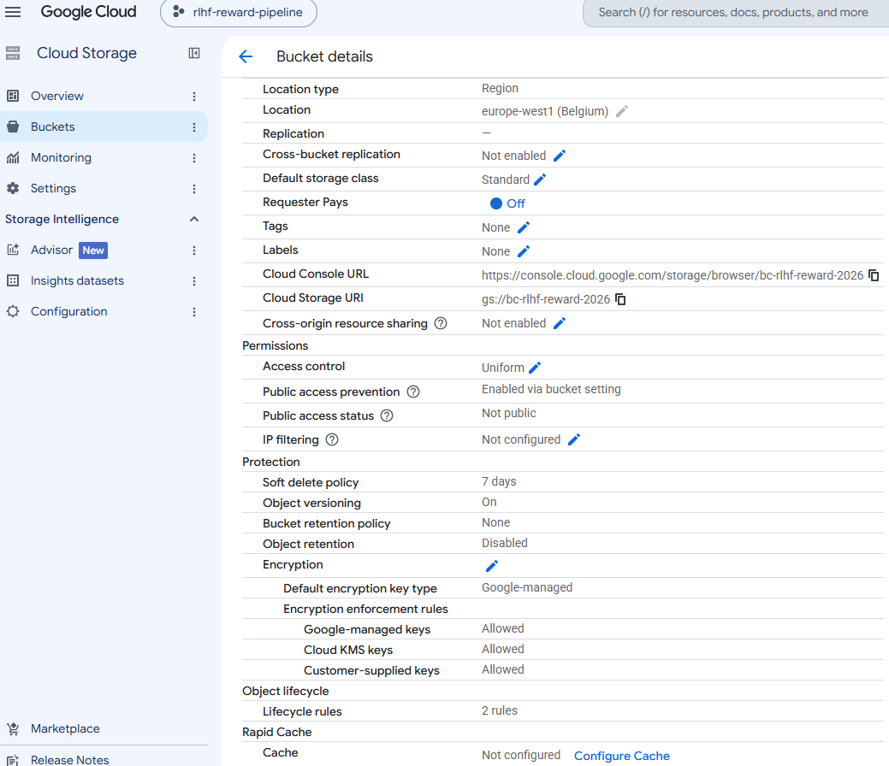
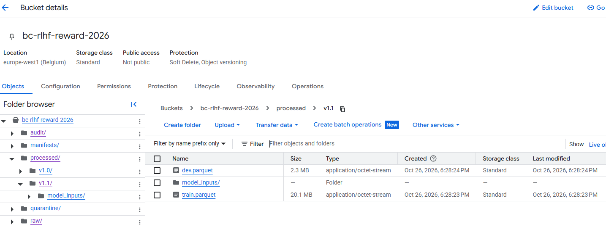

# 👍👎 Response Preference Prediction (RLHF Reward Modelling) — Milestone 2

This is Milestone 2 of my Data Handling and Infrastructure for AI project. It picks up where Milestone 1 left off, in [bounchun/rlhf-reward-model-pipeline-m1](https://github.com/bounchun/rlhf-reward-model-pipeline-m1) (release `data-v1.0`), and the full commit history came across with it, so you can trace how the project got from M1 to M2. This README is self-contained: you do not need the M1 report to follow it.

How it is organised:
1. [Project summary and Milestone 1 decisions](#m20-project-summary-and-milestone-1-decisions): what the project is and what was already decided.
2. [Revised decisions](#m24-changes-since-v10-and-why): what changed after Milestone 1, and why.
3. Milestone 2 implementation and evidence: [pipeline](#m21-pipeline-architecture), [storage](#m22-storage-implementation-and-evidence), [EDA](#m23-what-the-eda-found-and-what-it-changed).
4. [Results and validation](#m25-v11-run-on-the-real-data), then [limitations and reflection](#m26-limitations-and-reflection).

| | |
|---|---|
| **Task** | Given a conversation and two replies, predict which one a crowdworker preferred (reward modelling for RLHF) |
| **Data** | [`Anthropic/hh-rlhf`](https://huggingface.co/datasets/Anthropic/hh-rlhf), MIT licence, pinned to commit `09be8c5bbc57cb3887f3a9732ad6aa7ec602a1fa` |
| **Dataset version** | v1.1 (M1 was v1.0). The raw data and split haven’t changed. M2 adds new validation checks, moves failed rows into quarantine instead of dropping them, masks personal data, and produces inputs the model can use directly |

### M2.0 Project summary and Milestone 1 decisions

This project prepares the data for an RLHF reward model : given a conversation and two possible replies, predict which one the crowdworker preferred. In Milestone 1 I picked the dataset, decided how to split it and where to store it, and built a pipeline that downloads, cleans, splits and uploads the data to Google Cloud Storage (release data-v1.0). Milestone 2 starts from that working pipeline and adds to it: exploratory analysis, data contracts, a quarantine for bad rows, monitoring, and an independent check of the results. The table below lists the Milestone 1 decisions I kept. The ones I changed are in [M2.4](#m24-changes-since-v10-and-why).


| Decision | Summary |
|---|---|
| Task and target | A yes/no prediction: `label` = 1 if reply A was the preferred one. The model sees the conversation and the two replies. Subset, split and the flags are only used to break down the results, never as inputs |
| Split | Pairs are grouped by their first Human message (hashed), so the same prompt never ends up in two splits. 20% of the groups are held back as "future" data (F1, F2). The remaining 30,002-pair working set is split 80/10/10 using `sha256(group_id + salt) % 10`. Anything learned from the data is fitted on train only |
| Storage | Google Cloud Storage rather than a database, because the data is written once in batches and training reads whole files, with no queries in between. There are two buckets: `gs://bc-rlhf-reward-2026` (Standard) and `gs://bc-rlhf-reward-2026-holdout` (Coldline, for test, F1 and F2). [M2.2](#m22-storage-implementation-and-evidence) shows how this was set up and what changed in M2 |
| Formats | Raw files stay as the original JSONL.gz. Processed data is Parquet, manifests are JSON, and audit files are CSV or JSON |
| Versioning | Each version gets its own `vMAJOR.MINOR` folder, a manifest and a Git tag (`data-v1.0`, now `data-v1.1`). The MINOR number goes up when the cleaning rules change |
| Bias and poisoning | The audit plan and the poisoning defences are in sections 11–12 of the M1 README. M2 adds the datasheet and the leakage audit |


## 🧭 Milestone 2 at a glance (dataset version v1.1)

| Milestone 2 requirement | Where it is |
|---|---|
| EDA that drives decisions | `src/eda.py` (run it with `make eda`) produces 9 figures, `docs/eda/eda_summary.json` and `docs/eda/findings.csv`, which links each finding to the decision it led to and its limits. The summary is in [M2.3](#m23-what-the-eda-found-and-what-it-changed) |
| Pipeline: acquire → validate → store → transform | Steps 1–11, all run by (`make all`). The full pipeline is laid out in [M2.1](#m21-pipeline-architecture) |
| Storage implementation | Two GCS buckets, set up by a script and used by every step through the same few storage functions. The manifest records each stored file's location, SHA-256 and row count, and the files are checked again when read back from the bucket. See [M2.2](#m22-storage-implementation-and-evidence) |
| Validation that fails loudly | `src/contract.py` holds two data contracts. The raw one runs in step 3: any row that fails goes to a quarantine file with the reason, the source file and the line number. The processed one runs in step 9, checks 17 rules and logs the results to `audit/v1.1/validation_log.csv`. If a HARD rule fails, the pipeline stops before anything is uploaded |
| Cleaning and transformation | In step 3 the text gets normalised, PII is masked, and anything broken is quarantined (there are 7 reasons a row can end up there). Step 5 does the A/B swap and builds the features. Step 7 adds an outlier flag, using thresholds fitted on the training set only. Step 11 gets everything ready for the model: long contexts are cut from the left, and the log-length features are scaled with the training mean and standard deviation.|
| Second method / reconciliation | `src/reconcile.py` (run it with `make reconcile`) recounts everything straight from the raw files in plain Python, without using any pipeline code. All 7 of its checks have to match the pipeline's numbers |
| Reproducibility | The data commit and library versions are pinned and the splits are hash-based, so a rerun gives byte-identical output, and a test checks this. On every push, GitHub Actions runs the 43 tests and an offline demo (`.github/workflows/ci.yml`) |
| Changes since v1.0 | [M2.4](#m24-changes-since-v10-and-why) |
| Limitations and reflection | [M2.6](#m26-limitations-and-reflection) | 

### M2.1 Pipeline architecture

```text
make all  (Colab or locally · runs the steps in order, top to bottom,
│          and each step writes its log to manifests/v1.1.json).
│
├── 1 SOURCE  (one-off manual setup, not part of make all)
│   ├── Anthropic/hh-rlhf          Hugging Face, MIT licence, commit 09be8c5 pinned
│   │
│   └── setup_gcs.sh               creates 2 buckets (versioning + lifecycle),
│                                  2 service accounts: pipeline-sa writes, train-sa reads main only
│
├── 2 INGEST
│   ├── step1_scrape_raw           downloads the 8 raw files from Hugging Face over HTTPS
│   │                              (4 subsets: helpful-base, harmless-base, helpful-online,
│   │                              helpful-rejection-sampled; a train and a test file for each)
│   │                              ──▶ data/downloads/ (local), every file's SHA-256 checked
│   │                              against the hashes pinned in manifests/raw-<commit>.json
│   │                                   
│   └── step2_store_raw            uploads the 8 files to raw/ in the main bucket, reads each one
│                                  back and checks its SHA-256 again. raw/ is write-once: a file
│                                  that already exists is never overwritten
│                                  ──▶ gs://bc-rlhf-reward-2026/raw/hh-rlhf/<commit>/
│
├── 3 VALIDATE
│   ├── step3_clean                reads the raw files back from raw/ in the bucket, checks each
│   │                              row against the data contract and masks e-mails and phone numbers
│   │                              rejected rows (reason, file, line) ──▶ main: quarantine/v1.1/
│   │                              clean rows ──▶ data/interim/ (local, not uploaded yet)
│   │   
│   ├── step4_quality_checks       runs the hard checks (any failure stops the run), screens for
│   │                              data poisoning and checks that no e-mail or phone number is left
│   │                              report + flagged pairs ──▶ main bucket: audit/v1.1/
│   │
│   └╌╌ beam_validate              optional (make beam, not in make all): runs step 3's data
│                                  contract again with Apache Beam on this machine, checks
│                                  that every count matches step 3's
│
├── 4 TRANSFORM
│   ├── step5_features             gives each pair a prompt-group id (hash of first Human message),
│   │                              puts the preferred reply in A or B by hash so the label is 0 or 1,
│   │                              and adds reply lengths and refusal flags ──▶ data/interim/ (local) 
│   │ 
│   ├── step6_filter               sets aside 20% of the prompt groups as "future" data (F1, F2)
│   │                              and picks a 30,002-pair working set from the rest,
│   │                              taking whole prompt groups only ──▶ data/interim/ (local) 
│   │  
│   ├── step7_split                splits the working set 80/10/10 into train, dev and test by the
│   │                              hash of the prompt group, so a prompt never appears in 2 splits;
│   │                              flags very long replies, with the cut-off taken from train only
│   │                              ──▶ data/interim/ (local)
│   │  
│   └── step8_shard                off by default: the data is small enough that one file per split
│                                  is quicker to write and read than many shards 
│
├── 5 STORE
│   ├── step9_store_processed      checks every split against the 17-rule data contract first;
│   │                              if a HARD rule fails, the run stops and nothing is uploaded
│   │                              contract results ──▶ main bucket: audit/v1.1/validation_log.csv
│   │                              train, dev    ──▶ main bucket: processed/v1.1/
│   │                              test, F1, F2  ──▶ holdout bucket: v1.1/
│   │    
│   ├── step10_review_sample       picks 200 train pairs (spread across the 4 subsets) for me to
│   │                              label by hand, with crowdworker's choice hidden
│   │                              review sheet  ──▶ audit/label_review_v1.1.csv
│   │                                                (local only: it contains harmful text,
│   │                                                 so it is never uploaded or committed to Git)
│   │ 
│   └── step11_model_inputs        reads 5 splits back from the buckets and gets them ready for
│                                  the model: long contexts are cut from the left
│                                  (newest turns kept, max 256 words), the log lengths are scaled
│                                  with train's mean/standard deviation,
│                                  which are saved in numeric_scaler.json for M3
│                                  train, dev, scaler ▶ main bucket: processed/v1.1/model_inputs/
│                                  test, F1, F2 ──▶ holdout bucket: v1.1/model_inputs/
│
└── 6 CHECK
    ├── sample_queries             reads train and dev back from the main bucket and runs a few
    │                              example pandas queries on them, to check the stored data makes
    │                              sense (never reads the holdout bucket)
    │                              results ──▶ main bucket: audit/v1.1/sample_queries.json
    │    
    ├── reconcile                  recounts everything straight from the raw files in plain Python,
    │                              without the pipeline code, and reads the 5 stored splits back
    │                              from the buckets; all 7 checks must match the pipeline's numbers
    │                              results ──▶ main bucket: audit/v1.1/reconciliation.json
    │
    └── eda                        reads train, dev and the quarantine from the main bucket (never
                                   the holdout bucket) and turns them into 9 figures, a summary and
                                   a findings table linking each finding to a pipeline decision
                                   figures, eda_summary.json, findings.csv ─▶ GitHub: docs/eda/
                                   (aggregates only, no dataset text, so safe to commit)


gs://bc-rlhf-reward-2026           (main bucket · Standard storage· versioning on) 
├── raw/                           original Hugging Face files, never changed: if a cleaning
│                                  rule turns out to be wrong, I fix it and rerun from these
│                                    
├── quarantine/v1.1/               rows rejected by step 3, each with the reason and the file
│                                  and line it came from; kept instead of deleted
│  
├── processed/v1.1/                train.parquet and dev.parquet: cleaned, checked against 
│   │                              17-rule contract, ready for training (test stays in holdout bucket)
│   │
│   └── model_inputs/              train and dev ready for the model, plus numeric_scaler.json
│                                  (train mean/standard deviation) ──▶ what M3 trains on
│
├── audit/v1.1/                    the proof the data was checked: contract results (step 9),
│                                  quality report (step 4), sample queries and reconciliation
│
└── manifests/                     v1.1.json: what every step did (counts, settings, file hashes);
                                   a copy is committed to GitHub in manifests/

gs://bc-rlhf-reward-2026-holdout   (holdout bucket: Coldline storage, train-sa has no access)
└── v1.1/                          test, future_f1 and future_f2, plus their model_inputs/;
                                   read only once, for the final evaluation

```

**ETL rather than ELT.** All the transformations (parsing the conversations, swapping A and B, hashing the groups and masking personal data) are written in Python rather than SQL. The raw files only add up to 79 MB, so everything runs in a single Python process, which takes about 2½ minutes for steps 1 to 11. Only the cleaned Parquet files get loaded into storage for use. The raw files are still kept as they are, in a write-once, versioned bucket, so I can still do what ELT is good for: change a rule and rerun everything from the raw data. I looked at Apache Beam and Dataflow (Lecture 6), but at this size they would cost more and add extra setup for no real gain. The pipeline still uses the same ideas, though: every row is checked against a data contract, rejected rows go to quarantine with a reason, each step keeps counts, reruns give the same result, and an independent recount checks the final numbers.

### M2.2 Storage: implementation and evidence

In Milestone 1 I chose object storage and explained why, so I won’t go over that again here. This section is about how it works in practice: how the storage is configured, how the data is organised and accessed, how each pipeline step uses them, and what I changed after Milestone 1. The buckets were created in Milestone 1. For v1.1 I kept them, added new folders and checks, and filled them with a full Colab run on 26 October 2026.

**How it is configured.** `scripts/setup_gcs.sh` creates both buckets in one go (cell 0b of the Colab notebook runs it too). Because the setup is a script rather than manual clicks in the console, anyone can repeat it exactly.


| Setting | Main bucket `gs://bc-rlhf-reward-2026` | Holdout bucket `gs://bc-rlhf-reward-2026-holdout` | Reason |
|---|---|---|---|
| Location | `europe-west1` (Belgium) | `europe-west1` | A single region near Dublin is enough. The data can be rebuilt from the raw files, so paying extra for multi-region copies isn’t worth it|
| Storage class | Standard | Coldline | Standard for data in daily use (train, dev); Coldline is cheaper for data kept aside and opened rarely (test, F1, F2) |
| Access control | Uniform bucket-level access, public access prevention on | Same | One set of IAM rules covers the whole bucket, so no single file can be shared by mistake; the harmful text in the data must never be public |
| Object versioning | On | On | A bad rerun or an accidental delete doesn’t lose data: the previous version is kept|
| Lifecycle (`scripts/gcs_lifecycle.json`) | Delete a non-current version when 4 newer ones exist or after 90 days | Same | Keeps recent versions for recovery but deletes older ones, so costs stay small |
| IAM | `pipeline-sa`: objectAdmin · `train-sa`: objectViewer | `pipeline-sa`: objectAdmin · `train-sa`: no role | The training account is given read access to train and dev only, and no access to the test set |


**How the data is organised.** Each dataset version has its own folders (`processed/v1.1/`, `quarantine/v1.1/`, `audit/v1.1/` and `v1.1/` in the holdout bucket). That way v1.0 and v1.1 can sit side by side, and a new version never overwrites an old one. Raw files are stored under the Hugging Face commit they came from (`raw/hh-rlhf/<commit>/<subset>/<split>.jsonl.gz`), so files from another version of the dataset can't get mixed in. The full layout is in the bucket tree in [M2.1](#m21-pipeline-architecture). The interim files (`data/interim/`) are never uploaded, because until the split is made they still contain the test rows.


**How it is accessed.** Every read and write goes through one small storage layer in `src/common.py` (`write_bytes`, `read_bytes`, `read_parquet` and `exists`), which uses `gcsfs` with Application Default Credentials (Google login in Colab). The bucket name is taken from the `DHAI_BUCKET` Colab Secret or environment variable, so it doesn't appear in the code or in `config.json`, and there is no service account key file anywhere. If `DHAI_BUCKET` is left empty, the same code writes to `data/lake/` and `data/holdout/` on disk instead. That is how CI (Continuous Integration) runs the 43 tests and the offline demo without a Google Cloud account. 


**How it fits into the pipeline.** Storage isn't just where the data ends up. Several later steps read their input back from the buckets, so they work on exactly what was stored rather than on a local copy that might differ.  


| Step | Reads | Writes | Storage check |
|---|---|---|---|
| 2. Store raw | local downloads | `raw/hh-rlhf/<commit>/…` | Each file's SHA-256 is checked before upload, and again after reading it back; `raw/` is write-once, so a file with different content stops the run |
| 3. Clean | `raw/` from the bucket | `quarantine/v1.1/quarantine.parquet` | Each raw file’s SHA-256 is checked again before any row is read | 
| 4. Quality checks | local cleaned data | `audit/v1.1/` | — |
| 9. Store processed | local splits | `processed/v1.1/{train,dev}`; holdout `v1.1/{test,future_f1,future_f2}` | Every split is checked against the 17-rule contract before upload; if a HARD rule fails, no split is uploaded (only the contract log, to show what failed). Each stored file's location (URI), hash, size (bytes) and row count are saved in the manifest |
| 11. Model inputs | all 5 splits from the buckets | `processed/v1.1/model_inputs/` and holdout `v1.1/model_inputs/` | The scaling uses the train mean and standard deviation only, saved in `numeric_scaler.json` so every split is scaled the same way |
| Sample queries, EDA | train/dev and quarantine from the main bucket (EDA also uses the local cleaned data) | `audit/v1.1/`, `docs/eda/` | Never read the holdout bucket |
| Reconcile | `raw/` and all 5 stored splits from the buckets | `audit/v1.1/reconciliation.json` | Stored files must match the manifest's SHA-256 and row counts |

**Evidence.**

- **The manifest.** `manifests/v1.1.json`, with a copy in `gs://bc-rlhf-reward-2026/manifests/`, lists every stored file with its `gs://` location, SHA-256 hash, size and row count. For example, `gs://bc-rlhf-reward-2026/processed/v1.1/train.parquet` has 24,122 rows (20.1 MB), and `gs://bc-rlhf-reward-2026-holdout/v1.1/test.parquet` has 3,004 rows.
- **The reconciliation.** It reads the five splits back from the buckets: all SHA-256 hashes and row counts match the manifest.
- **The Colab notebook.** The "Verify the buckets and read a file back" cell lists the contents of both buckets and loads `dev.parquet` directly from GCS (`Rows loaded: 2,876`).
  
- Screenshots of the main bucket settings and of the four v1.1 folders after the run:

*Main bucket settings: region, uniform access, public access prevention, versioning, 2 lifecycle rules*




*(a) Main bucket, `processed/v1.1/`*




*(b) Main bucket, `quarantine/v1.1/`*


*(c) Main bucket, `audit/v1.1/` (with `validation_log.csv` and `reconciliation.json`)*


*(d) Holdout bucket (Coldline), `v1.1/`*


**What changed after Milestone 1.** The bucket design (two buckets, storage classes, versioning, IAM roles) is unchanged, since the v1.0 run showed it worked well. What changed is how the pipeline uses the buckets: 

| Refinement | Why |
|---|---|
| New `quarantine/<version>/` folder | Rejected rows are kept with reason, file and line, instead of being dropped (Lecture 6) |
| New `audit/<version>/` folder with `validation_log.csv` and `reconciliation.json` | The proof that the data was checked is stored next to the data |
| Processed data contract runs **before** upload | A bad split can no longer reach the bucket |
| New `model_inputs/` in both buckets, with the train-fitted scaler | Milestone 3 reads ready-to-use inputs; the test inputs stay in the holdout bucket |
| Step 11, the EDA and the reconciliation read from the buckets | Downstream work and checks use what is actually stored |

### M2.3 What the EDA found, and what it changed

All numbers come from `make eda` on the real data (`docs/eda/eda_summary.json`). Structure and quality checks look at all rows; distributions and relationships use **train only**; baselines are fitted on train and scored on dev; the holdout bucket is never read.

| # | Finding (real data, v1.1) | Decision in the pipeline |
|---|---|---|
| 1 | In the raw files the preferred reply is **always** `chosen`: a model could reach 100% by learning the column | A/B swap by `hash(pair_id)`; label share now 49.8% in train |
| 2 | 1,323 of 169,352 raw pairs break a rule; the rate differs by subset (13.0 per 1,000 in helpful-rejection-sampled vs 4.7 in harmless-base; χ² p = 6e-65, Cramér's V = 0.04), so the problems are not "missing completely at random" | Quarantine with reason and source line instead of a silent drop; `rows_read = kept + quarantined` asserted (fig. 1) |
| 3 | 93% of pairs share their opening prompt with another pair, and 92% of official test pairs have their prompt in the official train split | Confirms the M1 group split; contract rule "no `group_id` in two splits" (fig. 2) |
| 4 | Reply length is right-skewed (skew 2.0, −0.4 after `log1p`); the 1.5×IQR fence would flag 5% of replies | Flag (not delete) above the train 99th percentile (210 words); `log1p` lengths in step 11 (fig. 3) |
| 5 | 9.7% of train contexts are longer than 256 words | Step 11 keeps the newest turns (left truncation) and records `context_truncated` |
| 6 | The preferred reply is longer in 58% of helpful-base pairs but only 42% of harmless-base pairs; pooled (52%) this cancels out (Cramér's V = 0.14) | Length is a shortcut that depends on the subset: M3 reports accuracy per subset and per length-gap slice (fig. 4) |
| 7 | Length alone gets 51.4% on dev pooled, but 58.2% with one length model per subset | These are the baselines the M3 reward model must beat on every subset (fig. 5) |
| 8 | 47% of replies use the typographic apostrophe ’, so the v1.0 refusal regex (straight `'`) flagged only 0.09% of pairs | Refusal phrases rebuilt from the data and made apostrophe-agnostic: 2.2% flagged |
| 9 | When only one reply is a refusal, it is preferred in 75% of harmless-base pairs but 27% of helpful-base pairs | A second subset-dependent shortcut: refusal slice per subset in M3 (fig. 6) |
| 10 | Inputs are correlated: reply A vs B length ρ = 0.50 pooled but only 0.27–0.54 within subsets (the subsets differ in typical length); turns vs context words ρ = 0.82 | Use the log length ratio for linear baselines; the two-reply correlation is partly a subset effect, another reason to evaluate per subset (fig. 7) |
| 11 | Week 4 inference: rows are clustered in prompt groups, so intervals were recomputed with a group bootstrap (resampling prompt groups, not rows). Design effect only 1.07–1.15; helpful-base minus harmless-base length preference = 16.1 points (95% CI 14.3–17.8); the length effect replicates on held-out dev in all 4 subsets; all 4 tests stay significant after Benjamini–Hochberg | M3 reports group-bootstrap intervals; per-subset test accuracy can only be known to ±3–5 points, so smaller per-subset differences will not be claimed (fig. 8) |
| 12 | Week 5 cross-validation: two scikit-learn Pipelines (a ColumnTransformer length × subset model, and a bag-of-words model whose vocabulary is learned inside each fold) give the same accuracy with random-row folds and with `GroupKFold` on prompt groups (gap ≤ 0.2 points), but group folds vary more between folds | GroupKFold for any CV in M3; bag of words (54.8% dev) is the first text baseline. No measurable inflation from random-row folds for these reply-only models (which does not prove leakage is absent); a model that also reads the prompt could still memorise it (fig. 9) |
| 13 | 304 pairs contain an e-mail and 724 a phone-like number | Masked as `[EMAIL]` / `[PHONE]`; step 4 checks that none is left |

### Lecture 6: the six qualities of a trustworthy pipeline

| Quality | How this pipeline has it |
|---|---|
| Repeatable | Pinned data commit and libraries, hash-based splits; a full rerun gives byte-identical Parquet files and EDA figures |
| Idempotent | Every output file is replaced as a whole (like `WRITE_TRUNCATE`), never appended; `raw/` is write-once and refuses different bytes |
| Observable | Counters printed by every step and stored in the manifest; quarantine with reasons; per-file quarantine rate and JSON-field fingerprint (schema drift) with alerts |
| Testable | 43 unit tests on synthetic data with planted defects, run by GitHub Actions on every push |
| Fails loudly | Checksum mismatch, row-accounting gap, HARD contract violation, reconciliation disagreement or (optionally) an alert stops the run |
| Cost-aware | 79 MB batch: one Python process (~2.5 min) instead of Dataflow workers; Colab and CI are free; buckets are a few hundred MB with lifecycle rules |

**Apache Beam (optional, `make beam`).** `src/beam_validate.py` runs step 3's data contract as a Beam pipeline: a file-reading `DoFn`, a `Validate` `DoFn` with a tagged `bad` output, Beam `Metrics` counters and a `CombinePerKey` for duplicates. It then compares every counter with the pandas step 3. On the real data all 10 counts agree (169,352 read, 168,029 kept, 1,323 quarantined, by reason). The comparison earned its place: in the first version, Beam's built-in `.gz` reading returned only 44,044 rows, and the mismatch exposed it at once. Running it on Dataflow is planned, not implemented: the code uses only portable Beam transforms and should run with `--runner DataflowRunner` and `apache-beam[gcp]`, but it has not been tested there, because at this size the workers would cost more to start than the job takes on one machine.

### From lectures to pipeline rules (Weeks 4–6)

| Lecture | Finding or principle | Evidence in the EDA | Pipeline rule | Test that guards it |
|---|---|---|---|---|
| Week 4 | Repeated prompts break row independence | 93% of pairs share a prompt; 92% of official test prompts in official train | Group split; group bootstrap for intervals | `test_no_group_or_pair_overlap_between_any_splits`, contract rule "no group_id in two splits" |
| Week 4 | Significance is not effect size | χ² p-values next to Cramér's V and a 16.1-point risk difference with CI | Effect sizes and intervals reported with every test | `test_group_bootstrap_widens_intervals_for_clustered_rows`, `test_benjamini_hochberg` |
| Week 5 | Pooled results hide subset effects (Simpson) | Length and refusal effects reverse between subsets | Per-subset baselines and evaluation slices fixed in `config.json` | `test_eda_writes_figures_and_findings_without_reading_the_holdout` |
| Week 5 | Investigate outliers before removing them | 1.5×IQR would flag 5% of valid replies | Flag above the train P99; `log1p` features | `test_outlier_threshold_fitted_on_train_only` |
| Week 5 | Preprocessing must not learn from held-out data | Scaler, threshold and TF-IDF fitted on train / training folds | Train-fitted step 11 scaler; `GroupKFold` | `test_scaler_is_fitted_on_train_only`, `test_text_features_are_learned_on_the_training_fold_only` |
| Week 6 | Invalid data must stay auditable | 1,323 rule violations, uneven by subset | Quarantine with reason + row accounting | `test_every_row_read_is_kept_or_quarantined`, `test_processed_contract_catches_a_corrupted_copy` |
| Week 6 | Pipelines must survive reruns and schema changes | One field shape in all 8 files; max reject rate 1.3% | Whole-file outputs, write-once raw, field fingerprint and alerts | `test_rerun_is_byte_identical`, `test_alerts_for_schema_drift_and_reject_spike` |
| Week 6 | Independent verification builds trust | Beam first read 44,044 of 169,352 rows | 7 reconciliation checks; Beam–pandas comparison | `test_reconciliation_catches_a_flipped_label`, `test_beam_pipeline_agrees_with_pandas_step3` |

### Leakage audit (Kapoor & Narayanan, 2023)

| Leakage type | Status in this project |
|---|---|
| L1.1 No test set | Group-held-out test set in a separate bucket that the training account cannot read |
| L1.2 Pre-processing on train and test | Outlier threshold, scaler and refusal phrases are derived from train only; tested |
| L1.3 Feature selection on train and test | No feature selection; evaluation slices fixed in `config.json` before the test set is used |
| L1.4 Duplicates | Exact duplicates quarantined; contract rule "no `pair_id` in two splits"; 0 repeated comparisons |
| L2 Illegitimate features | The `chosen` position is neutralised by the A/B swap; `subset`, `split` and the flags are evaluation variables, not model inputs |
| L3.1 Temporal leakage | No timestamps exist; F1/F2 are not truly later data (documented limitation) |
| L3.2 Non-independence between train and test | Split by prompt group; the official split would leak 92% of test prompts |
| L3.3 Sampling bias in the test distribution | Test is drawn like train (same subset mix): it represents this collection process, not real users |

The dataset itself is documented in **[`docs/DATASHEET.md`](docs/DATASHEET.md)**, following Gebru et al. (2021).

### M2.4 Changes since v1.0, and why

The data split is **unchanged** (same salts), and so are the two buckets and their access rules; how the pipeline uses the storage was refined (see [M2.2](#m22-storage-implementation-and-evidence)). v1.1 is a MINOR version (M1 versioning rule: cleaning rules changed, split unchanged), and the run confirms it: train / dev / test / F1 / F2 have exactly the same sizes, groups and label shares as v1.0.

| Change | Why |
|---|---|
| Storage use: new `quarantine/`, `audit/` and `model_inputs/` folders; contract checked before upload; later steps read back from the buckets | Milestone 2 asks for storage that supports the whole pipeline, not only a place to put the final files |
| Quarantine instead of dropping rows (`quarantine/v1.1/quarantine.parquet`) | Lecture 6: "don't crash, don't hide"; every rejected row keeps its reason, file and line number |
| Processed data contract + `validation_log.csv` | Lecture 5: record the rule, its rationale and the number of violations; stop before upload on a HARD violation |
| PII masking in step 3 (new reason `identical_after_pii_mask`: 1 pair) | Governance: the data should not carry e-mails or phone numbers; ids are computed before masking so pair ids and splits do not move |
| Refusal phrases v1.1 | EDA finding 8 (planned in the M1 README) |
| Step 11 model-ready inputs | Lecture 5: fit on train, transform every split; prepares M3 |
| `reconcile.py`, `eda.py`, CI workflow | Evidence that the pipeline is correct and reproducible |

### M2.5 v1.1 run on the real data

| Check | Result |
|---|---|
| Raw input | 8 files, all SHA-256 checksums equal to `manifests/raw-09be8c5….json` |
| Row accounting (step 3) | 169,352 read = 168,029 kept + 1,323 quarantined (788 identical replies · 329 context mismatch · 194 empty · 11 malformed turns · 1 identical after PII masking) |
| Quality checks (step 4) | all 6 hard checks pass, 0 e-mail / phone patterns left, poisoning screen: 0 flagged |
| Splits (step 7) | train 24,122 · dev 2,876 · test 3,004 · F1 16,516 · F2 16,652 — identical to v1.0 |
| Data contract (step 9) | 17 rules × 5 splits, 0 violations, 0 warnings |
| Model inputs (step 11) | scaler fitted on 24,122 train rows; 9.7% of train contexts truncated (8.3% dev) |
| Reconciliation | all 7 independent checks agree |
| EDA | 9 figures + 13 findings in `docs/eda/` |
| Cross-validation (Lecture 5) | length × subset (ColumnTransformer pipeline): 56.9% random-row vs 56.7% group 5-fold CV, 57.9% dev; bag of words: 54.9% vs 54.9%, 54.8% dev |
| Storage (Colab run, 26 Oct 2026) | train/dev, model inputs, quarantine and audit files in `gs://bc-rlhf-reward-2026` (Standard); test/F1/F2 and their model inputs only in `gs://bc-rlhf-reward-2026-holdout` (Coldline); stored files re-read and matched to the manifest; manifest committed as `manifests/v1.1.json`, tag `data-v1.1`. Screenshots in [M2.2](#m22-storage-implementation-and-evidence) |

### M2.6 Limitations and reflection

The same limitations and reflection are in the report (section 7).

**Limitations**

| Limitation | Effect | What would address it |
|---|---|---|
| The Colab run signs in with my own Google account, not `pipeline-sa` | The service-account roles are configured but were not exercised, so "the training account cannot read the holdout bucket" is set up, not tested | Run the pipeline and a training read as the service accounts (impersonation) and record the expected 403 on the holdout bucket (Milestone 3) |
| One noisy label per pair (about 63% researcher agreement) | Caps the accuracy any model can reach; some "errors" will be label noise | Estimate the noise from the 200-pair review sheet |
| No timestamps in hh-rlhf | F1/F2 are held-out prompt groups, not later data, so they cannot measure drift over time | A preference dataset with collection dates |
| The test set represents this collection process (crowdworker prompts) | Results describe crowdworkers on these four subsets, not real users | Evaluate on a differently collected preference set |
| Per-subset test accuracy is only known to about ±3–5 points | Small differences between subsets cannot be claimed | Report group-bootstrap intervals; claim only differences larger than them |
| PII masking is pattern-based (e-mail, phone) | Names, addresses and other personal details in free text are not masked | A named-entity based PII detector |
| Single machine; Beam not run on Dataflow | Fine at 79 MB, untested at larger scale | Run `beam_validate.py` with `DataflowRunner` if the data grows |
| No `models/` folder yet | Model artefacts are not stored or versioned yet | Added in Milestone 3, in the main bucket and versioned like the data |

**Reflection**

- **Implementing storage early paid off:** because the buckets worked after Milestone 1, Milestone 2 could focus on how the pipeline uses them (checking before upload, keeping rejected rows, reading back to verify). Most of the trust in the data now comes from these checks rather than from the bucket itself.
- **The EDA changed the pipeline, not just the report:** the always-`chosen` label, the typographic apostrophe in the refusal rule and the subset-dependent length effect were each found in the data and each led to a code change and a test.
- **Independent checks caught a real bug:** the Beam comparison exposed a gzip reading problem (44,044 of 169,352 rows) that the pandas pipeline alone would not have shown. Next time I would build the reconciliation first, not last.
- **Precise claims:** reviewing the draft showed wording that said more than the evidence ("no leakage", "Dataflow-ready"); it now says "no measurable inflation for these models" and "planned, not implemented".
- **For Milestone 3:** train on `model_inputs/`, beat the per-subset length baseline on every subset, report group-bootstrap intervals, and test the service-account separation.

---

## ▶️ How to run it

**Option 1: quick check, no account needed (about 1 minute).** Open a new notebook at [colab.research.google.com](https://colab.research.google.com), paste this into one cell and run it:

```python
!git clone https://github.com/bounchun/rlhf-reward-model-pipeline-m2.git repo
%cd repo
!pip install -q -r requirements.txt
!make test
!DHAI_BUCKET= make demo && echo "demo OK"
```

It should end with `OK` (43 tests passed; the Apache Beam test runs when `requirements-beam.txt` is installed, as in CI) and `demo OK` (the whole pipeline, steps 1–11, the reconciliation and the EDA, run on fake data with planted problems). Nothing touches Google Cloud. The same two commands run on every push in GitHub Actions.

**Option 2: the full pipeline on the real data.** [](https://colab.research.google.com/github/bounchun/rlhf-reward-model-pipeline-m2/blob/main/notebooks/run_pipeline_colab.ipynb)
1. Click the badge, then File → Save a copy in Drive.
2. Add a Colab Secret (🔑 in the left sidebar): name `DHAI_BUCKET`, value = the name of a bucket in your own Google Cloud project, with notebook access switched on.
3. In the first code cell, set `GCP_PROJECT` to your project ID.
4. Run the cells from top to bottom. Run 0b once to create your buckets (skip it if they already exist from Milestone 1), and skip the cells marked *skip*.

The run takes about 5–10 minutes and gives the same numbers as in [M2.5](#m25-v11-run-on-the-real-data), because the split uses hashes, not random numbers. The EDA cells show the 9 figures inline, and the cell after them downloads `docs/eda/` and `manifests/v1.1.json` to commit. This is a new notebook for Milestone 2 only; the Milestone 1 notebook stays in the M1 repository.

To check the stored data without rerunning the pipeline, run only Settings, Install and Login, then the Verify the buckets and read a file back cell. Like Cell 8 of the GCS lab, it lists every file in both buckets and reads `dev.parquet` straight from the bucket with pandas. You should see the raw, quarantine, processed, audit and manifest files in the main bucket, only `test`, `future_f1`, `future_f2` and their `model_inputs` in the holdout bucket, and `Rows loaded: 2,876`. It shows only non-text columns, because the dataset contains harmful text.

**Option 3: on your own machine** (Python 3.13):
```bash
git clone https://github.com/bounchun/rlhf-reward-model-pipeline-m2 && cd rlhf-reward-model-pipeline-m2
pip install -r requirements.txt
make test && make demo                    # offline check
export DHAI_BUCKET=<your-bucket> && make all   # full run (steps 1-11, reconcile, eda), needs Google Cloud
DHAI_BUCKET= make all                          # or: full run with local folders instead of buckets
```

---

## 🛠️ Repository layout and pipeline steps

One Python script per step; each script says at the top what it reads, writes and checks, and records its counts, settings and checksums in `manifests/<version>.json`. `make all` runs steps 1–11, the sample queries, the reconciliation and the EDA in order.

| Step | Script (`src/`) | Input → output |
|---|---|---|
| 1 Acquire | `step1_scrape_raw.py` | Hugging Face (pinned commit; retries with backoff) → `data/downloads/`, `manifests/raw-⟨rev⟩.json` |
| 2 Store raw | `step2_store_raw.py` | → `gs://bc-rlhf-reward-2026/raw/` (write-once, read-back verified) |
| 3 Validate + clean | `step3_clean.py`, `contract.py` | raw → `cleaned.parquet` + quarantine with reasons; row accounting; PII masking; schema and reject-rate alerts |
| 4 Quality checks | `step4_quality_checks.py` | hard checks, poisoning screen, residual-PII check → `audit/<version>/` |
| 5 Features | `step5_features.py` | group keys, A/B swap → `label`, lengths, refusal flags |
| 6 Filter | `step6_filter.py` | future reserve F1/F2 + 30,002-pair working set (whole prompt groups) |
| 7 Split | `step7_split.py` | 80/10/10 train/dev/test by hashed group; outlier threshold fitted on train |
| 8 Shard | `step8_shard.py` | optional, off by default |
| 9 Store processed | `step9_store_processed.py`, `contract.py` | 17-rule data contract → `validation_log.csv`; Parquet to `processed/` and the holdout bucket |
| 10 Review sheet | `step10_review_sample.py`, `score_review.py` | blind 200-pair label review |
| 11 Model inputs | `step11_model_inputs.py` | `model_inputs/` for every split; scaler fitted on train |
| Check | `reconcile.py` | independent recount from the raw files: 7 checks |
| Check (optional) | `beam_validate.py` | step 3's contract on Apache Beam, compared with pandas (`make beam`) |
| EDA | `eda.py` | `docs/eda/`: 9 figures, `eda_summary.json`, `findings.csv` |
| Queries | `sample_queries.py` | example pandas queries on the stored train/dev data |

```
config.json                  every parameter: HF revision, salts, split buckets, thresholds, alerts, EDA settings
requirements.txt             pinned versions (Python 3.13); requirements-beam.txt: optional Apache Beam
Makefile                     make all | scrape | store | preprocess | queries | reconcile | eda | beam | test | demo
src/                         the steps above + common.py (storage, hashing, manifests) and text_utils.py
tests/                       43 unittest tests on synthetic data with planted defects (tests/fake_data.py)
notebooks/run_pipeline_colab.ipynb   Milestone 2 Colab runner: steps 1-11, reconcile, EDA figures (Google login + Colab Secret)
manifests/                   dataset manifests (lineage: checksums, counts, code commit)
docs/eda/                    EDA outputs (aggregates only, no dataset text)
docs/DATASHEET.md            datasheet for the processed v1.1 data
docs/architecture_m2.html    source of docs/img/architecture_m2.png
docs/img/m2_bucket*_v1.1.png bucket screenshots after the v1.1 Colab run
scripts/setup_gcs.sh         one-off bucket / IAM setup (from M1)
.github/workflows/ci.yml     tests + offline demo on every push
```

Interim files (`data/interim/`) stay local and are never committed: before the split they still contain test rows.

---

## 📚 References used in Milestone 2

- Bai, Y. et al. (2022). [*Training a Helpful and Harmless Assistant with RLHF*](https://arxiv.org/abs/2204.05862).
- Gebru, T. et al. (2021). [*Datasheets for Datasets*](https://arxiv.org/abs/1803.09010). Communications of the ACM, 64(12).
- Kapoor, S. and Narayanan, A. (2023). [*Leakage and the reproducibility crisis in ML-based science*](https://doi.org/10.1016/j.patter.2023.100804). Patterns, 4(9).
- Anscombe, F. J. (1973). Graphs in statistical analysis. *The American Statistician*, 27(1).
- Tukey, J. W. (1977). *Exploratory Data Analysis*. Addison-Wesley.
- Schutt, R. and O'Neil, C. (2013). *Doing Data Science*, ch. 2. O'Reilly.
- scikit-learn: [Common pitfalls and recommended practices](https://scikit-learn.org/stable/common_pitfalls.html).
- [Apache Beam programming guide](https://beam.apache.org/documentation/programming-guide/).
- Grósz, T. and Wahid, A. (2026). *Data Handling and Infrastructure for AI*, Lectures 4–6 and Labs 4–6, SETU.
- Rando, J. and Tramèr, F. (2024). [*Universal Jailbreak Backdoors from Poisoned Human Feedback*](https://arxiv.org/abs/2311.14455). ICLR.

The Milestone 1 reading list (bias, auditing, data poisoning, Google Cloud documentation) is in the [M1 README](https://github.com/bounchun/rlhf-reward-model-pipeline-m1#-further-resources).

---

## 💻 Author

**Boun Chun** · [@bounchun](https://github.com/bounchun)
